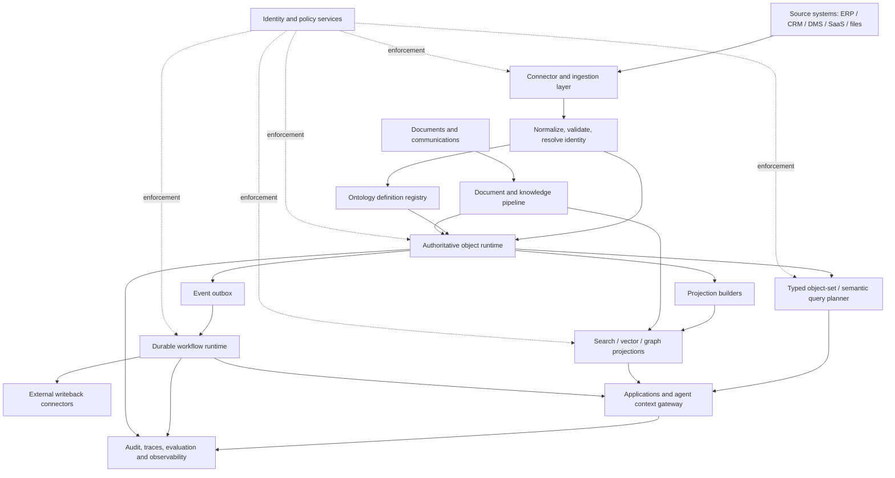

# System architecture

**Layer:** [00-overview](README.md) · **What it is:** The whole system on one page: the product thesis, the six research maps as one architecture, and the layer boundaries.

> Everything below is copied from the research with a link to where it came from. Nothing here is a new design. New, dated fact-check findings go in the "Fact-check notes" section only.

**Sources in this file:** [Palantir](#palantir) (2) · [Open-source implementations](#open-source-implementations) (1) · [Earlier engineering notes (Phase 2)](#earlier-engineering-notes-phase-2) (4)

## Diagram

_From the former `diagrams/system-boundaries.mmd`._

## Palantir

### 1. Architecture context: where the data layer sits

> Source: [general-references/01-palantir-data-layer.md § 1. Architecture context: where the data layer sits](../../general-references/01-palantir-data-layer.md#1-architecture-context-where-the-data-layer-sits)

**Plain English.** Foundry has three layers. The bottom one stores and computes on raw data. The middle one (the Ontology) turns rows into business objects such as "Order" or "Customer". The top one holds the apps and agents. This document is about the bottom layer and how it hands data upward.

**Detail.**
- Palantir calls the bottom layer the **Multimodal Data Plane (MMDP)**. It is drawn beneath the Ontology layer and has four parts. [Fact] https://www.palantir.com/docs/foundry/architecture-center/multimodal-data-plane/
  - **Open data layer:** Apache Iceberg is the primary table format, alongside media, documents, streams and geospatial data.
  - **Open compute layer:** autoscaling Spark for batch, autoscaling Flink for streaming, and single-node DataFusion, Polars and DuckDB. Compute Modules let customers bring their own containers, and compute can be pushed down to Databricks or Snowflake.
  - **Model layer.**
  - **Deployment layer:** Apollo.
- Every runtime runs on **Rubix**, a Kubernetes-based compute mesh. Each container is destroyed and recreated within **72 hours** (zero-trust node cycling). [Fact] same page
- Palantir describes transforms as running "south of the Ontology" (raw data → Ontology) and interactive functions as "north of the Ontology". [Fact] same page
- Scale claims: "300+ microservices" across AIP and Foundry; "tens of thousands" of Apollo releases per week. [Vendor claim] https://www.palantir.com/docs/foundry/architecture-center/overview/
- The architecture overview groups "Data Services" as connectivity, transformation, virtualisation, storage, health monitoring and management. [Fact] same page

**For the founder.** [Inference] The useful idea is the split: the raw data plane is commodity (open formats, swappable engines), and the value sits in the semantic layer above it. A 100–1,000-person company already has Postgres, a warehouse or SaaS APIs. Copy the *contract* between the layers, not the engines.

### 1. Overall AIP architecture (as Palantir's Architecture Center draws it)

> Source: [general-references/03-palantir-aip.md § 1. Overall AIP architecture (as Palantir's Architecture Center draws it)](../../general-references/03-palantir-aip.md#1-overall-aip-architecture-as-palantirs-architecture-center-draws-it)

**Plain English.** AIP is the layer that lets AI models read a company's modelled data, call its business logic and propose changes, all under the same permissions and audit trail as human users. Example: a supply-chain agent sees "Order" and "Plant" objects, calls a "reroute shipment" Action, and the edit is logged against a named user.

**Technical detail.** The Architecture Center lists 12 capability areas: secure LLM access, end-to-end observability, context engineering, the Ontology system, vector/compute/tool services, security and governance, agent lifecycle, operational automation, development environments, human-plus-AI applications, packaging and release, and "enterprise automation" (agents such as AI FDE and AIP Analyst that build on the platform itself). [Fact] https://palantir.com/docs/foundry/architecture-center/aip-architecture
- AIP and Foundry run on a shared service mesh, deployed by Apollo inside the "Rubix" substrate. [Fact] same URL.
- Context engineering covers batch, streaming and CDC replication on Spark, Flink, DataFusion and Polars runtimes. [Fact] same URL.
- The Ontology is described as unifying "data, logic, action, and security". Palantir claims it can query "billions" of objects and orchestrate "tens of thousands" of actions. [Vendor claim] same URL.
- The vector and tool services include integrated vectorisation, multi-node and single-node engines, bring-your-own containers, and a "tool factory" built from the Ontology. [Fact] same URL.
- Security is "role-, marking-, and purpose-based", and the page says it applies uniformly across UI, APIs and SDKs. [Fact] same URL.
- Agents work under the same change management as humans, such as Global Branching. [Fact] same URL.

[Inference] For a 100 to 1,000 person company, the parts that matter are: one model gateway, one semantic model with permissions, tools generated from that model, agents that run as a user, branch-and-proposal review for changes, and evals plus tracing. The multi-engine compute and Apollo deployment layers are overkill.

## Open-source implementations

### Proposed platform decomposition

> Source: [open-source-references/cross-repo-patterns.md](../../open-source-references/cross-repo-patterns.md#proposed-platform-decomposition)

**Proposed, not decided:**

1. Connectors and ingestion runtime.
2. Metadata/catalog and source-binding registry.
3. Ontology definition and version service.
4. Object runtime and object-set query interface.
5. Entity resolution and identity evidence.
6. Document/knowledge pipeline and hybrid retrieval.
7. Semantic metrics/query compiler.
8. Action engine with transaction/outbox.
9. Durable workflow engine.
10. Authorization/policy layer.
11. Agent runtime/tool gateway and ADLC.
12. Application/SDK and operations/observability.

The first implementation can package many of these as modules in a modular monolith. A service split is an operational decision, not a diagram aesthetic.

## Earlier engineering notes (Phase 2)

### 1. Original product thesis and baseline assumptions

> Source: former `01-reference-architecture/original-research-architecture.md` (moved here in the Nov 2026 restructure)

The original research did not start with “RAG for enterprise”. It started with a **company operating model that AI agents can safely work through**:

- A company has typed business objects, properties, identities, relationships, metrics, rules, permissions, evidence and named actions.
- Human applications, analysts and agents use the same governed model.
- Data from source systems is connected to that model; documents and extracted knowledge enrich it but do not silently become authoritative operational facts.
- Questions are answered through semantic/object queries and deterministic computation where possible. The model is used for language, interpretation and bounded reasoning—not as the source of truth for arithmetic, policy or state changes.
- Agents can propose and execute only the actions their identities and policies permit. Important actions have approvals, audit history and recovery semantics.

The assumptions embedded across original maps 30–35 were:

| Original assumption | Original research position |
|---|---|
| Initial buyer segment | Companies with roughly 100–1,000 staff |
| First workflow | Receivables and collections |
| Product | A company model / operational layer with agents, not a generic chatbot |
| Application stack | TypeScript, PostgreSQL with row-level security, one repository |
| Models | Rented through APIs; Claude and Qwen were the examples |
| System shape | One coherent codebase with explicit internal boundaries; not a requirement to copy Palantir's fleet of services |
| Data and state | Explicit source-of-truth, sync, object-edit, audit and action semantics |
| Product differentiator | Governed objects + rules + metrics + permissions + actions + agent procedures, rather than retrieval alone |

These are historical baseline assumptions, not a claim that receivables must remain the first commercial vertical forever. A later pivot to legal changes the **domain pack and market hypothesis**, not the need for an ontology/action platform. That pivot must be tested and recorded as a decision; it must not silently rewrite the provenance of the original research.

### 2. The actual architecture: six research maps, one system

> Source: former `01-reference-architecture/original-research-architecture.md` (moved here in the Nov 2026 restructure)

#### A. Data platform — source data becomes trustworthy operational state

**Primary source:** [Map 1 — Palantir platform](../../general-references/30-map-palantir-platform.md), design decision 2; [Palantir data-layer research](../../general-references/01-palantir-data-layer.md).

Responsibilities:

1. Source registry, connection setup, encrypted credentials, connector health and sync scheduling.
2. Raw landing and clean/normalized datasets, with source identifiers and lineage retained.
3. Snapshot and append sync first; CDC is a later capability when source volume and freshness justify it.
4. Dataset transactions, ordering/current-state rules, schema-drift policy, incremental rebuilds and deduplication.
5. Build/job dependency tracking, expectations, data health and operational alerts.
6. Explicit per-field/object ownership: source-owned, user-edited, computed, extracted or ephemeral.

The original map deliberately did **not** copy the entire Foundry lakehouse. Its baseline was a small Postgres-centred product for customers with a small number of SaaS/accounting sources. Iceberg, streaming/Flink, broad warehouse virtualization and an on-prem agent were not first-version requirements. Do not import those enterprise features without a customer need.

#### B. Ontology definition and object runtime — the company model

**Primary sources:** Map 1, design decisions 3–4 and 6–8; [Map 2 — Lingyang/Alibaba](../../general-references/31-map-lingyang-alibaba-offers.md), design decisions 1–2 and 10–13; [Map 4 — context/code/integration](../../general-references/33-map-context-code-integration.md), design decisions 1–2 and 12.

The model needs distinct concepts for:

- Versioned object/entity type definitions, property definitions, stable keys and validation.
- Typed relationships/links, cardinality and relationship semantics.
- Interfaces/shared properties and value types where the domain needs them.
- Mappings from source datasets/fields into typed ontology properties.
- Runtime object instances and relationship instances, stored separately from schema definitions.
- Source-backed values versus user edits/overlays, with deterministic merge precedence and conflict visibility.
- Object identity resolution when multiple systems refer to the same real-world entity.
- Model-pack versioning, validation, publication, compatibility and rollback.

The original study deliberately treats ontology definitions (the “TBox”/model) separately from runtime facts/instances (the “ABox”). It also separates an operational object from an extracted knowledge-graph assertion. A graph database alone does not provide this product. The follow-up schema-language audit now makes the concrete object/link/interface distinction, relationship backing and schema-evolution constraints explicit; see [Phase 2 schema-language and relationship research](../03-ontology-engine/object-type-registry.md).

#### C. Read/query and semantic computation — answer with typed meaning

**Primary sources:** Map 1, decision 6–7; Map 2, decisions 3–5 and 9–11; [Map 3 — research and cost](../../general-references/32-map-research-and-cost.md), decisions 1–3 and 8–10; Map 4, decisions 11–12.

Required surfaces:

1. An object-set/query abstraction for filtering, traversing, selecting, aggregating and paging typed business objects.
2. A semantic query path for business metrics; metric definitions carry grain, dimensions, filters, time periods and valid joins.
3. A deterministic planner that validates schema paths, relationship direction/cardinality, join grain, time bounds, permissions, limits and backend capability.
4. An inspectable typed query plan and explain output; natural language may propose a plan, but the server validates it.
5. Functions/derived properties and rules with declared inputs, outputs, versions and execution boundaries.
6. Arithmetic, reconciliation and numeric reasoning executed by deterministic code/SQL, with a trace. Text-to-SQL is a guarded fallback, not the default semantic contract.
7. Document retrieval and graph traversal only when they improve a defined question; “multi-hop” does not mean every query must traverse a graph.

MetricFlow, UModel, OpenSPG/KAG and TypeDB are complementary evidence for planning and validation. They are not interchangeable products.

#### D. Rules, actions and state mutation — agents do not write arbitrary rows

**Primary sources:** Map 1, decisions 8–11 and 19–20; Map 2, decisions 2, 6 and 12; Map 3, decisions 10–11; Map 4, decision 13; [Map 6 — market/competitors](../../general-references/35-map-market-and-competitors.md), decisions 4–10 and 12–15.

The action plane requires:

- Named, typed action definitions with input schema, preconditions, validation, permissions, expected state transition and audit metadata.
- A risk class per action: allowed automatically, approval required, or prohibited. The model must not set or weaken its own authority.
- A preview/dry-run path with the intended object diff, applicable rules, effects and required approver.
- Server-side re-checks of authorization, current object version, policy and approval at execution time.
- A clear transaction boundary for canonical state, edit history, audit and outbox intent.
- Reliable external side effects via durable outbox/workflow, idempotency keys, retry policy and reconciliation. A webhook is not automatically part of a database transaction.
- Scenarios/simulations for “what if” evaluation without mutating production state.
- Versioned rules, named owners, proposal/review/approval, effective dates and rollback.

The action registry is shared by the UI and agent tools. A human button and an agent tool should invoke the same server-side operation and policy checks. Agents must not be granted direct database write access.

#### E. Knowledge and context — evidence complements the operational model

**Primary sources:** Map 2, decisions 7–11; Map 3, decisions 4–9 and 15–17; Map 4, decisions 7–10.

This plane handles documents, messages, unstructured knowledge and memory:

- Preserve source document identity, version, location, access controls and precise source spans.
- Parse and chunk documents with structural context; retain links from chunks and extracted claims back to the exact source version.
- Represent extracted entities/facts/claims with confidence and review state. Distinguish candidate, corroborated, verified, rejected, contradicted and superseded facts.
- Keep temporal validity separate from when the system learned/recorded a fact.
- Maintain separate auto-learned and human-certified knowledge; define explicit merge precedence rather than letting the latest model output win.
- Use hybrid lexical/vector retrieval, reranking and graph traversal when appropriate, always applying the same tenant/resource permissions as the source.
- Keep user/session memory separate from canonical business facts and from the knowledge base.

This is where RAG, graph retrieval and context engineering belong. They are important platform capabilities, but they are not the ontology itself and do not replace typed query/action semantics.

#### F. Agent, workflow and application lifecycle — a governed operator, not a prompt

**Primary sources:** Map 1, decisions 12–21; Map 2, decisions 12–17; Map 3, decisions 11–19; [Map 5 — agent companies](../../general-references/34-map-agent-companies.md), decisions 2–17; Map 6, decisions 12–15.

The system needs:

- A model gateway with provider abstraction, budgets, rate limits, usage attribution, routing and retention controls.
- Separate human, service and agent identities. Agent permissions are the intersection of the initiating user, agent role, tenant/resource scope and action capability—not a blanket service credential.
- Typed tools for object lookup, semantic query, document retrieval, approved actions and workflow status. Read tools can be available by default; write tools require explicit enabling and policy.
- Procedure/SOP artifacts with versioned instructions, tool contracts, constraints, examples, risk level and evaluation requirements.
- Durable workflows for timers, long-running tasks, approval waits, customer replies, retries, cancellations and recovery.
- A human handoff path and a kill switch for autonomous work.
- Traces, action audit, model/tool costs, evaluations, golden cases, simulations, regressions, experiments, canaries and immutable release snapshots.
- MCP as an integration surface for discovery and tool/resource delivery—not as a replacement for the domain API or authorization layer.
- Human applications and developer tooling on top of the same object/query/action contracts.

### 7. Decision rules for the next architecture revision

> Source: former `01-reference-architecture/original-research-architecture.md` (moved here in the Nov 2026 restructure)

1. Map every proposed module to a section in one or more of the six reference maps, or label it as a new proposal.
2. Keep documented competitor mechanisms, repository observations, inferences and our own decisions separate.
3. Record source-of-truth ownership for every important object/property.
4. Do not let graph/vector/search projections become authoritative by accident.
5. Do not let an agent write raw database rows or bypass named action contracts.
6. Treat authorization as a cross-plane invariant; test revocation and matter/tenant scope through every retrieval and execution path.
7. Treat external side effects as a recoverable workflow, not as a magical extension of a database transaction.
8. Do not choose Neo4j, TypeDB, Temporal, DBOS, OpenFGA, OPA/Cedar or a vector store from a feature list. Run the decision tests and record the trade-offs.
9. Preserve original maps 30–35 as source documents. Newer architecture synthesis may add findings but must not silently rewrite historical evidence.
10. Keep the legal pivot explicit and reversible until buyer/workflow evidence supports it.

### 8. Source map index

> Source: former `01-reference-architecture/original-research-architecture.md` (moved here in the Nov 2026 restructure)

- [Map 1 — Palantir platform](../../general-references/30-map-palantir-platform.md)
- [Map 2 — Lingyang and Alibaba](../../general-references/31-map-lingyang-alibaba-offers.md)
- [Map 3 — research and cost](../../general-references/32-map-research-and-cost.md)
- [Map 4 — context, code and integration](../../general-references/33-map-context-code-integration.md)
- [Map 5 — agent companies](../../general-references/34-map-agent-companies.md)
- [Map 6 — market and competitors](../../general-references/35-map-market-and-competitors.md)
- [Original verification report](../../research-log/verification-report-21-nov-2026.md)

## Fact-check notes

_No time-sensitive claims in this component were re-checked in the 28 Nov 2026 pass; its sources are dated 21–27 Nov 2026. See the linked references for their own open questions._

## Gaps

- No lingyang, AgentOne and Alibaba material in the research yet.
- No other companies and products material in the research yet.
- No research literature material in the research yet.
