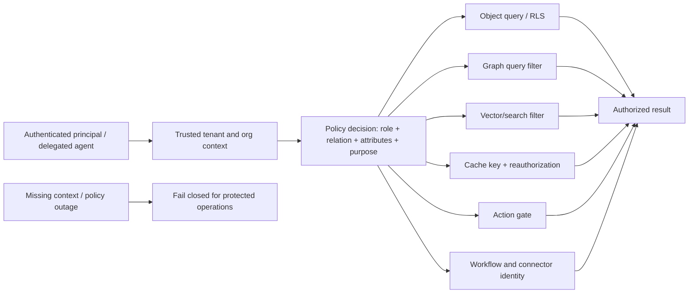

# Authorization model

**Layer:** [01-security](README.md) · **What it is:** How allow/deny decisions are made on data, objects, links, actions and functions, and which engine evaluates them.

> Everything below is copied from the research with a link to where it came from. Nothing here is a new design. New, dated fact-check findings go in the "Fact-check notes" section only.

**Sources in this file:** [Palantir](#palantir) (2) · [Open-source implementations](#open-source-implementations) (7) · [Other companies and products](#other-companies-and-products) (1) · [Design decisions already in the reference maps](#design-decisions-already-in-the-reference-maps) (1) · [Earlier engineering notes (Phase 2)](#earlier-engineering-notes-phase-2) (1)

## Diagram

_From the former `diagrams/security-enforcement.mmd`._

## Palantir

### 10. Ontology permissions (object types, links, actions, functions; project-based vs datasource-derived)

> Source: [general-references/04-palantir-security.md § 10. Ontology permissions (object types, links, actions, functions; project-based vs datasource-derived)](../../general-references/04-palantir-security.md#10-ontology-permissions-object-types-links-actions-functions-project-based-vs-datasource-derived)

**Plain English.** Seeing that an object type "Building" exists is different from seeing the buildings. The type definition is permissioned like a file in a Project. The rows are permissioned by the object security policy or by the datasource.

**Technical detail.**
- **Project-based (current default for new Ontologies):** Ontology resources live in a Project, and the Project role decides who can view or edit their definitions. Viewer on an object type shows schema and contacts but not data. [Fact] https://www.palantir.com/docs/foundry/object-permissioning/ontology-permissions/
- **Legacy models:** in the datasource-derived model, you are editor on the object type if and only if you are editor on the datasource. In the Ontology-roles model, there are Ontology viewer, editor and owner roles. [Fact] same URL.
- **Edit rules:** editing a link type requires edit on the link type and on both object types. Editing an action type requires edit on it and on every type it edits. [Fact] same URL.
- **Objects with no backing datasource** must be saved in a Project and must have an object security policy. [Fact] https://palantir.com/docs/foundry/ontologies/ontology-permissions/
- **Functions:** executing one needs Viewer on the repository where it was published (otherwise `ReadFunctionsPermissionDenied`), and the function must be registered. Functions run as the calling user, so the same function returns different rows to different users. For function-backed actions, end users need only action permissions. Admin allowlists control "extended execution" (calling actions; tokens with a TTL of up to 4 hours). [Fact] https://palantir.com/docs/foundry/functions/permissions/
- **Downloads** are checked on the object type for Project-based types, and on the backing datasource otherwise. [Fact] https://www.palantir.com/docs/foundry/object-permissioning/object-security-policies/

### 8. Action and object permissions

> Source: [general-references/02-palantir-ontology.md § 8. Action and object permissions](../../general-references/02-palantir-ontology.md#8-action-and-object-permissions)

Plain English: three separate questions: can you see this kind of thing, can you see these specific things, and may you perform this operation on them with these inputs?

Technical detail:
- **Project-based permissions** (current model): ontology resources are saved in projects; project roles (Viewer, Editor, Owner) govern who can view, edit and manage them; markings or roleless projects hide them. Viewing an object type's schema needs View on the object type, not on the datasource; seeing objects additionally needs data access via object/property security policies or View on the backing datasource. Editing a link needs edit on the link type and both object types; editing or running an action needs edit on the action type and all edited resource types. The legacy model used Ontology `viewer`/`editor`/`owner` roles managed in Ontology Manager, and before that permissions derived from datasources. [Fact] https://www.palantir.com/docs/foundry/object-permissioning/ontology-permissions/
- **Applying an action** requires: view on the edited types and their datasources; passing submission criteria; for types editable "only via actions" (the default for new types) only Read on edited objects, which means users can create objects they cannot view; for types editable by other means, Edit on the writeback dataset (discouraged because Edit exposes all writeback data); passing a restricted view's edit policy; permissions on the action log type if enabled. Read-time policies (restricted views, object and property security policies) filter what an action can read but not what it writes. [Fact] https://www.palantir.com/docs/foundry/action-types/permissions/
- **Multi-datasource checks:** create needs view on the datasources whose properties are set; modify needs view of existing values of the edited properties (others appear null during validation); delete needs view of the whole object; links need ability to load both objects. [Fact] https://www.palantir.com/docs/foundry/object-edits/permission-checks/
- **Read and write authorizations** on action types: a read boundary limits which marked data an action may load even if the user could; a write boundary enforces a minimum security level on created or modified data; if they differ, declassification permission is checked at save/publish time. Platform-managed writes (action logs, edit history) are exempt. [Fact] https://www.palantir.com/docs/foundry/action-types/read-write-authorizations/
- **Object and property security policies:** row-level (object policy) and column-level (property policies) combine to cell-level; primary key cannot be in a property policy; each property in at most one property policy; granular policy comparison weight ≤ 10,000 (object policy alone, or object policy plus one property policy). Policy conditions in code: and/or, static group membership, user's groups match a property, marking property. Recommended over restricted views (cell level, near-instant updates, streaming and branching support). Editing policies needs project Owner. A "Test security policies" modal previews what a chosen user would see. [Fact] https://www.palantir.com/docs/foundry/object-permissioning/object-security-policies/ ; `maker/src/api/object/SecurityCondition.ts`
- Palantir's design guidance: start restrictive; one object type with policies, not duplicated types per audience; avoid ad hoc filtering in application code. [Fact] https://palantir.com/docs/foundry/ontology/ontology-structural-guidance/

## Open-source implementations

### 17. Cedar

> Source: [open-source-references/cedar.md](../../open-source-references/cedar.md) (code study)

- Apache-2.0, Rust, workspace version 4.15.0, last commit 2026-11-20. [Fact]
- Crates: `cedar-policy` (API), `-core` (parser, evaluator, validator, batched evaluator, `tpe`), `-cli`, `-formatter`, `-symcc` (symbolic compilation), a language server, and `cedar-wasm`. [Fact]
- Type-aware partial evaluation (`cedar-policy/src/api/tpe.rs`):
  - `PolicySet::tpe` returns a decision, or residual policies that can be inspected as a structured tree.
  - `is_authorized_batched` loads entities on demand through an `EntityLoader`, up to `max_iters` times.
  - `query_resource` and `query_principal` answer "which resources may this principal act on" or "which principals may act on this resource", given a known type.
  - `query_action` is also present.

  The `tpe` feature is listed under `experimental` in `cedar-policy/Cargo.toml`. [Fact] ([tpe.rs](https://github.com/cedar-policy/cedar/blob/HEAD/cedar-policy/src/api/tpe.rs))
- `cedar-wasm` is published as `@cedar-policy/cedar-wasm` in ESM, Node/CommonJS and web flavours. It is built with features `["wasm", "partial-eval"]`, not `tpe`. [Fact] ([cedar-wasm/Cargo.toml](https://github.com/cedar-policy/cedar/blob/HEAD/cedar-wasm/Cargo.toml), [README](https://github.com/cedar-policy/cedar/blob/HEAD/cedar-wasm/README.md))
- Verdict: **adopt `@cedar-policy/cedar-wasm` as a dependency** for "may principal P run action A on object O with context C". Write the "filter the list of objects" path yourself in SQL, because resource queries are not in the wasm build. [Inference]

### 18. Open Policy Agent

> Source: [open-source-references/opa.md](../../open-source-references/opa.md) (code study)

- Apache-2.0, Go (about 478k lines), version 1.23.0-dev, last commit 2026-11-20. [Fact]
- The compile API (`v1/server/compile_handler.go`, `v1/rego/compile/compile.go`) runs partial evaluation with post-checks that decide whether a residual can become a filter for a given target. Targets are UCAST (all, minimal, Prisma, LINQ), SQL (PostgreSQL, MySQL, SQL Server, SQLite) and Lucene/Solr, selected by `application/vnd.opa.*` media types. [Fact] ([compile_handler.go](https://github.com/open-policy-agent/opa/blob/HEAD/v1/server/compile_handler.go))
- Verdict: **consider as a sidecar** only if you want policy authors to write Rego and get SQL `WHERE` clauses back. For one person, a Go sidecar plus Rego is a second language and a second service. **Copy the design** of "partial evaluation → check translatability → emit SQL fragment". [Inference]

### 19. OpenFGA

> Source: [open-source-references/openfga.md](../../open-source-references/openfga.md) (code study)

- Apache-2.0, Go (about 185k lines), last commit 2026-11-20. It uses CEL (`cel.dev/cel-go` v0.33.2) for conditional tuples. [Fact]
- The Postgres schema (`assets/migrations/postgres/001_initialize_schema.sql`) has `tuple(store, object_type, object_id, relation, _user, user_type, ulid, inserted_at)` with primary key `(store, object_type, object_id, relation, _user)` and partial indexes for user versus userset. It also has `authorization_model(store, id, type, type_definition BYTEA)`, `changelog` for the watch API, and `assertion`. Migration 005 adds `condition_name` and `condition_context` to tuples. [Fact] ([migrations](https://github.com/openfga/openfga/tree/HEAD/assets/migrations/postgres))
- Verdict: **copy the tuple-table design** if you need relationship-based sharing ("viewer of this account because member of team T, which owns region R"). Run OpenFGA itself only if relationship graphs become deep; at 100–1,000 staff, group and role grants in Postgres are likely enough. [Inference]

### Repository audit — openfga/openfga

> Source: [open-source-references/openfga.md](../../open-source-references/openfga.md) (repository audit)

**Role:** relationship-based authorization model and evaluation reference.  
**Repository:** [openfga/openfga](https://github.com/openfga/openfga), branch `main`.  
**Validation:** type-system source and module/test inventory inspected; full check evaluator trace and test execution remain open.

#### What was inspected

- `pkg/typesystem/typesystem.go` and its tests.
- `internal/check/check.go`, `bottom_up.go`, `recursive.go`, request/response and corresponding tests were inventoried.

#### Type-system validation path

`TypeSystem.New()` constructs internal relation/type graphs. The source warns that an invalid/untrusted model can cause graph construction to panic and recommends `NewAndValidate()` for untrusted model input. `NewAndValidate()` constructs a type-system shell, validates schema-version support and the model's constraints before graph construction. Methods such as `IsPubliclyAssignable()` and `PubliclyAssignableReferences()` reason over relation references and directly related user types.

The check subsystem contains dedicated bottom-up and recursive evaluators, request/response types, strategies and tests. A complete implementation audit should follow request parsing → model lookup → type-system resolution → tuple datastore lookup → recursive userset expansion → contextual tuple conditions → response/consistency metadata → cache and metrics.

#### Architecture use

OpenFGA is a good reference for relationship-based authorization (ReBAC): a resource's access is derived from modelled relations and tuples, not only static user roles. That can express relationships such as “user is a member of this matter's legal team” or “this agent is delegated by a responsible lawyer”.

#### Boundary and warning

An authorization decision service does not automatically enforce policy on Postgres rows, vector search, a graph store, a cache, a background workflow or an external SaaS API. Every consumer must call the policy engine or compile equivalent constraints into its data access path. A separate tenancy boundary may still require database isolation/RLS. Do not use OpenFGA as a substitute for transactional action preconditions or tenant partitioning.

#### Follow-up audit

Trace full check request and recursive evaluation; inspect datastore adapters, caching, consistency tokens, model/version selection, tuple conditions and batch APIs. Execute the full check/type-system test suites before adopting.

### OpenFGA: recursive authorization, cache consistency and design implications — Phase 2

> Source: [open-source-references/openfga.md](../../open-source-references/openfga.md) (repository audit)

**Snapshot:** `openfga/openfga` main at `d67ba7b1d2eaf945cffab3a9129ca1a4c7ad5251` (27 November 2026).  
**Evidence level:** source and test sources inspected; no code/tests executed. Official query consistency documentation checked.

Pinned code links:

- [recursive evaluator](https://github.com/openfga/openfga/blob/d67ba7b1d2eaf945cffab3a9129ca1a4c7ad5251/internal/check/recursive.go)
- [recursive evaluator tests](https://github.com/openfga/openfga/blob/d67ba7b1d2eaf945cffab3a9129ca1a4c7ad5251/internal/check/recursive_test.go)
- [cache controller](https://github.com/openfga/openfga/blob/d67ba7b1d2eaf945cffab3a9129ca1a4c7ad5251/internal/cachecontroller/cache_controller.go)
- [OpenFGA query consistency modes](https://openfga.dev/docs/interacting/consistency)

#### Finding 1 — relationship checks are a bounded recursive graph evaluation, not a simple edge lookup

The recursive evaluator handles userset and tuple-to-userset (TTU) rewrites. It bootstraps left and right tuple streams, traverses in a breadth-first manner, uses visited state to avoid repeated resolution, applies a configured concurrency limit and propagates context cancellation. The code comments explain that a repeated node is not always a cycle: diamond-shaped membership can converge on a shared group without a cycle.

The inspected recursive tests include nested membership, false/true resolution, error paths, cancellation/leak checks and a complex model with union, intersection, exclusion and recursive tuple cycles. This is a useful warning against implementing authorization by a naive recursive SQL or graph traversal that can loop, fan out without bounds or misclassify shared paths.

**Design implication (proposed):** represent authorization as a separately versioned policy/relationship graph with a formally bounded evaluator. Test cycles, diamonds, recursive group membership, cancellation, fanout limits and model migration. The business ontology graph may supply resource relationships, but it should not implicitly become the authorization engine.

#### Finding 2 — cache consistency is a security decision, not just a performance knob

The OpenFGA cache controller inspected in source performs asynchronous invalidation based on datastore changelog timestamps. On a cache miss, it may return a zero timestamp and permit use of the cache while invalidation runs; its own comment acknowledges that stale cache hits can occur until invalidation completes. It is an eventual-consistency optimization.

OpenFGA's official consistency documentation says `MINIMIZE_LATENCY` may use cache, while `HIGHER_CONSISTENCY` skips the cache and reads directly from the database. A tuple write followed immediately by a `Check` using the latency mode may not see the permission change if a cached result is served. Higher consistency trades latency for fresher policy state.

**Design implication (proposed):** decide consistency per operation. A dashboard may tolerate a short stale window; matter access, privilege revocation, external sharing, privileged export and irreversible write actions generally should not rely on a stale positive authorization cache. For critical operations, use a policy check with the stronger consistency mode or a version/fencing mechanism tied to the relevant authorization revision. Measure the latency cost rather than selecting the strongest mode everywhere.

#### Fit with an enterprise ontology

OpenFGA solves **who can do what to which object under which relationship/policy model**. It does not itself define the rich business object schema, ingest source data, reconcile entities, provide evidence-linked document retrieval or orchestrate long-running business workflows. It can be used behind the ontology service as an authorization decision point, with a controlled mapping from ontology object IDs and relationships to policy tuples.

Do not equate “the graph contains a `Matter -> Client` edge” with “this user is allowed to read the Matter.” Business semantics and access-control semantics can be related, but must be independently governed.

#### Highest-value follow-up tests

- Revoke a user or group membership, then attempt access immediately through every cache mode.
- Confirm high-risk action paths request stronger consistency and do not reuse a stale authorization decision.
- Test recursive union/intersection/exclusion, diamonds, cycles, deep nesting, cancellation and concurrency limits.
- Test policy model version changes, tuple migrations and cache invalidation across multiple instances.
- Confirm authorization failures do not leak resource existence or sensitive relationship topology.

#### What remains unverified

This is not a full OpenFGA datastore or consistency implementation audit. The cache controller read here is an in-memory cache mechanism; its exact relationship to a production deployment depends on configuration. No performance measurements or revocation-latency experiments were run.

### OPA — policy decision evaluation and HTTP enforcement adapter

> Source: [open-source-references/opa.md](../../open-source-references/opa.md) (repository audit)

#### Relevant code

- [Rego evaluation API](https://github.com/open-policy-agent/opa/blob/main/v1/rego/rego.go)
- [Bundle compiler](https://github.com/open-policy-agent/opa/blob/main/v1/compile/compile.go)
- [HTTP authorizer](https://github.com/open-policy-agent/opa/blob/main/v1/server/authorizer/authorizer.go)
- [Authorizer test directory](https://github.com/open-policy-agent/opa/tree/main/v1/server/authorizer)

#### Trace — request to decision to guarded handler

`authorizer.Basic.ServeHTTP` parses the HTTP request into policy input containing path, method, query parameters, headers and (where expected) parsed request body. It adds authenticated identity and client-certificate data if available in request context. It then constructs a Rego query using the configured decision reference, compiler, store and input, and evaluates it.

The result handling is deliberate:

- no result is an internal error: a configured authorizer with no policy is treated as misconfiguration, not implicit allow;
- a Boolean result is interpreted directly;
- a structured object can contain `allowed` and `reason`;
- only a positive allow calls the wrapped handler; otherwise it returns unauthorized.

The OPA compiler is a separate capability: its target field supports output formats such as Rego, Wasm and plan. It is not a SQL generator or an ontology query engine. The `PreparedEvalQuery` API supports compiling/preparing policy state and evaluating it repeatedly with request inputs.

#### What we should learn

- Treat policy evaluation as a reusable PDP (policy decision point) separate from PEP enforcement in each service/gateway.
- Missing policy or malformed policy output must fail closed.
- Supply a structured, trusted identity/context input rather than accepting tenant/role claims directly from user payloads.
- Use prepared policy evaluation/caches carefully; invalidate on policy revision and avoid cross-tenant cache reuse.
- Ensure every object read, object list, property projection, graph traversal, vector retrieval, action, workflow, export and agent tool is actually behind a PEP.

#### Important boundary

OPA can decide whether a request is allowed, but OPA does not automatically filter SQL rows, graph nodes, vector results or cached objects. The application must apply policy to the correct resource context and enforce the result in each data path. “We installed OPA” is not an authorization architecture.

### 10. A policy engine is not end-to-end authorization by itself

> Source: [open-source-references/cross-repo-patterns.md](../../open-source-references/cross-repo-patterns.md#10-a-policy-engine-is-not-end-to-end-authorization-by-itself)

OPA's HTTP authorizer converts path, method, params, headers, body and trusted request identity into Rego input. It fails closed when a configured policy has no result. But that only protects handlers actually placed behind that middleware. OpenFGA/OPA evaluation must be wired into list, object, graph, search/vector, cache, workflow and tool execution paths; a policy decision is not automatically a row filter.

**Design implication:** specify the PDP, policy input contract and PEP coverage map separately. Test all data access paths with the same cross-tenant denial suite.

## Other companies and products

### Harvey: ethical walls (permission model)

> Source: [general-references/12-agent-companies.md § Harvey: ethical walls (permission model)](../../general-references/12-agent-companies.md#harvey-ethical-walls-permission-model)

Plain English. A law firm may act for Company A while other lawyers in the firm must not see A's documents (a conflict). The wall says who can or cannot see a matter. Harvey must apply it everywhere: search, chat, agents, sharing and memory.

- Data model: Client Matter (open or walled), Wall (inclusionary or exclusionary), and membership sets stored once per workspace. Each set is fingerprinted by a hash of the normalised member list, is never edited in place, and a changed wall is repointed to a new set. Resource links connect Vault projects and files, conversations, review tables and Spaces to matters, and a file can carry its own matter link. [Fact] https://www.harvey.ai/blog/building-ethical-wall-enforcement-into-harvey
- Sync: separate matter-sync and wall-sync jobs on Temporal, with schedules, bulk runs and on-demand refresh, plus webhooks where available. Failures keep the last known policy. Users are matched by email, and an unmatched person on an inclusionary wall stays excluded. The largest workspace has about 1.7M matters. [Fact] same URL
- Enforcement: one policy engine. Access needs the resource permission plus clearance for every linked matter. A conversation inherits the matters of every attached file and every Vault source, and keeps them after a file is removed. Retrieval filters the index before ranking, then re-checks each file against stored policy before any content goes to the model. Scheduled agents run as their creator and check each file. Matter-tied memories check the wall. Shares are checked on share and again on open. Unauthorised items respond as if they do not exist. No admin bypass. Audit events cover wall create, change and remove, exportable by API. [Fact] same URL. iManage wall extension post (29 Oct 2026) not opened. [Unverified]

## Design decisions already in the reference maps

### 3. Permissions: tenant row-level security, label (marking) filters, object policies, Cedar for action decisions

> Source: [general-references/33-map-context-code-integration.md § 3. Permissions: tenant row-level security, label (marking) filters, object policies, Cedar for action decisions](../../general-references/33-map-context-code-integration.md#3-permissions-tenant-row-level-security-label-marking-filters-object-policies-cedar-for-action-decisions)

**Purpose.** Make it impossible for an agent or a staff member to see or change data they should not, whatever the agent asks for. The context layer itself never grants access. Receivables example: a collector sees only customers in their own portfolio; the external customer-messaging agent sees only the one customer it is talking to and never sees internal notes marked `internal-only`.

**Design to implement**, in four layers, applied in this order on every query:

1. **Tenant isolation in Postgres (forced RLS).** `org_id` column on every table, indexed; `ENABLE` and `FORCE ROW LEVEL SECURITY`; policy `USING (org_id = current_setting('app.org_id', true)) WITH CHECK (same)`; a dedicated non-owner application login role; each request inside a transaction that starts with `SET LOCAL app.org_id = $1` (Przyval/openfoundry migration 009 [Fact]). The fail-closed behaviour of an unset setting and the `SET LOCAL` scope are from document 14's knowledge of Postgres and marked [Unverified against docs this session].
2. **Markings (labels).** Each object row, property and document chunk can carry markings. A user must hold every mandatory marking and at least one discretionary marking if any are present; unknown markings are treated as mandatory (Przyval marking evaluator [Fact]). Resource roles held on a resource (owner, editor, viewer, discoverer) inherited by contents (Przyval migration 014 [Fact]). Granting can pass on only what the granter holds (Cognee [Fact]).
3. **Per-object-type access policies**, Cube's shape: per group `memberLevel {includes|excludes}`, `memberMasking`, `rowLevel {filters | allowAll}` (filters may interpolate user attributes), `conditions [{if: …}]`. Combination: policies within one object type are OR-ed; constraints across object types are AND-ed; once any group policy exists, groups without one get nothing (default deny); a path that resolves to no object instance is denied by injecting `1 = 0`; an empty `memberLevel` grants every member, so warn on it (Cube validator and compiler [Fact]). Add relationship-based scoping in the Workday style ("collector of this portfolio", "manager of region X") [Vendor claim, Workday]. Version 2, if sharing graphs get deep: OpenFGA-style tuple table `tuple(store, object_type, object_id, relation, user, user_type, condition_name, condition_context)` copied as design [Fact]; document 14 judges group and role grants in Postgres likely enough at 100–1,000 staff [Inference].
   - Implementation: a hand-written TypeScript compiler folds layers 2 and 3 into SQL predicates on every ObjectSet query (section 12). This is required because Cedar's resource-query APIs are not in the wasm build (below) and OPA's SQL compile target would add a Go sidecar and Rego [Fact for both facts; Inference for the choice].
4. **Action decisions with Cedar.** `@cedar-policy/cedar-wasm` 4.15 answers "may principal P run action A on object O with context C" [Fact: published in ESM, Node and web builds with features `wasm` and `partial-eval`, not `tpe`]. The action's own authorization-policy fields (copied from CapTrix, design only): `required_permission_keys`, `any_role`, `all_roles`, `attribute_equals`, `allowed_markings`, `minimum_clearance`, `deny_guest_sessions`, plus `confirmation_required` with a mandatory justification [Fact]. [Inference] Compile these fields into Cedar policies at definition-save time so there is one evaluator.

Governance precedence, fixed in the runtime: tenant policy, then role, then developer instructions, then the user's prompt (Fabric data agent [Fact]).

Pass-through rule: agents read with the invoking principal's permissions (Fabric, Google, OpenAI [Fact]); missing access is flagged, or the agent falls back to what the user can read (OpenAI [Fact]). Do not copy Airbyte's model where the stored service credential decides what the agent sees (document 24 [Fact for the model]). Masked or regulated values never go into metadata fields (Snowflake warning [Fact]).

Failure behaviour: any evaluation error denies. Unknown marking = mandatory. Unresolvable path = `1 = 0`. Cedar errors = deny with `PERMISSION_DENIED` (Conjure error code, section 12).

**Copies.**
- Document 14, section 20 and "What to copy" 10: forced RLS pattern. https://github.com/Przyval/openfoundry/blob/HEAD/db/migrations/009_multi_tenancy.sql ; https://github.com/Przyval/openfoundry/blob/HEAD/packages/db/src/pg-store.ts
- Document 14, "What to copy" 11: markings and resource grants. https://github.com/Przyval/openfoundry/blob/HEAD/packages/markings/src/marking-evaluator.ts ; https://github.com/Przyval/openfoundry/blob/HEAD/db/migrations/014_resource_authorization.sql
- Document 14, section 5 and document 11, section 11: Cube policies and combination semantics. https://github.com/cube-js/cube/blob/HEAD/packages/cubejs-schema-compiler/src/compiler/CubeValidator.ts ; https://github.com/cube-js/cube/blob/HEAD/packages/cubejs-server-core/src/core/CompilerApi.ts ; https://docs.cube.dev/reference/data-modeling/data-access-policies.md
- Document 11, section 9: Workday contextual security. https://blog.workday.com/en-us/four-layers-workday-data-cloud.html
- Document 14, section 17: Cedar wasm features. https://github.com/cedar-policy/cedar/blob/HEAD/cedar-wasm/Cargo.toml ; https://github.com/cedar-policy/cedar/blob/HEAD/cedar-policy/src/api/tpe.rs
- Document 14, section 3: CapTrix action authorization policy (design only). https://github.com/CapTrix/openfoundry/blob/HEAD/libs/ontology-kernel/models/action_type.go
- Document 14, section 14: Cognee grant-only-what-you-hold. https://github.com/topoteretes/cognee/blob/HEAD/cognee/modules/users/permissions/permission_types.py
- Document 11, section 2: Fabric governance precedence. https://learn.microsoft.com/en-us/fabric/data-science/concept-data-agent
- Document 11, "Key findings" 6 and section 7: pass-through permissions. https://openai.com/index/inside-our-in-house-data-agent/

**Left out, and why.** OPA as a sidecar (second language, second service, document 14). OpenFGA as a running service (version 2 at most). foundry-ontology-open's permission checks (placeholders; any user with one role can read [Fact]). Cedar `tpe` (experimental, not in wasm [Fact]). Account-wide snippet visibility (Databricks beta hole [Fact]).

**Open questions.** Whether Cedar resource queries will reach `cedar-wasm` (document 14 open item). Postgres RLS semantics need re-checking against the Postgres docs (see Gaps). How masking interacts with metric aggregation (Cube masks members outside the policy's row filter [Fact]; [Inference] aggregate metrics over masked rows need an explicit rule).

## Earlier engineering notes (Phase 2)

### Security model

> Source: former `09-security-and-governance/authorization-and-tenant-isolation.md` (moved here in the Nov 2026 restructure)

Use multiple layers with explicit responsibilities:

- Authentication: identity provider and session/token validation.
- Tenant context: derived from trusted identity/organisation membership; never accept a caller-controlled tenant header without gateway overwrite/verification.
- ReBAC: resource relationships such as matter team, client role, assigned operator and delegated agent (OpenFGA-style model).
- ABAC/policy: sensitivity, jurisdiction, matter status, purpose, time and action risk (OPA/Cedar-style policy evaluation).
- Data-plane enforcement: Postgres RLS, repository tenant predicates, graph/vector filters and storage namespace controls.
- Object/field/action security: resource permission, property masking and action-specific checks.
- Agent controls: tool allow-list, principal delegation, purpose limitation, approval and audit.

## Fact-check notes

_Not yet checked against current sources in this pass._

## Gaps

- No lingyang, AgentOne and Alibaba material in the research yet.
- No research literature material in the research yet.
