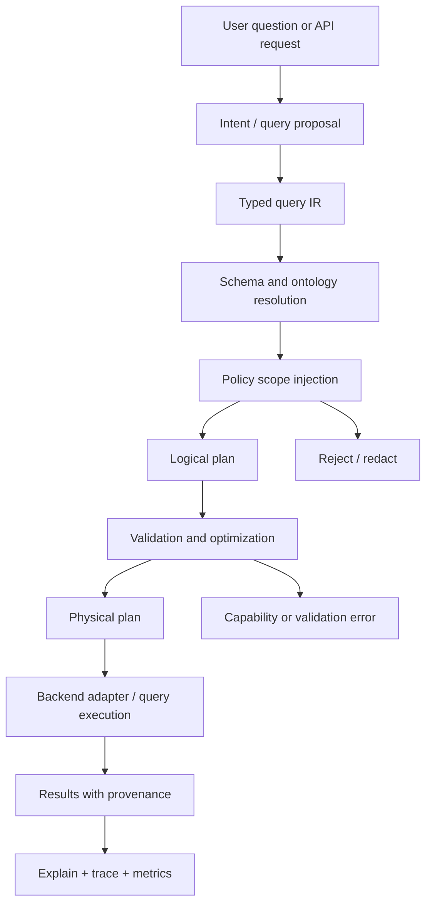

# Query plans and compiler

**Layer:** [04-query-and-metrics](README.md) · **What it is:** Turning a question into an inspectable, typed plan, then into executed steps (logical, optimised, physical).

> Everything below is copied from the research with a link to where it came from. Nothing here is a new design. New, dated fact-check findings go in the "Fact-check notes" section only.

**Sources in this file:** [Open-source implementations](#open-source-implementations) (5) · [Design decisions already in the reference maps](#design-decisions-already-in-the-reference-maps) (1) · [Earlier engineering notes (Phase 2)](#earlier-engineering-notes-phase-2) (2)

## Diagram

_From the former `diagrams/query-compiler-and-execution.mmd`._



## Open-source implementations

### Repository audit — OpenSPG and KAG

> Source: [open-source-references/openspg-kag.md](../../open-source-references/openspg-kag.md) (repository audit)

**Projects:** [OpenSPG/openspg](https://github.com/OpenSPG/openspg) and [OpenSPG/KAG](https://github.com/OpenSPG/KAG). These are related projects in the same ecosystem, but they are not the same runtime. OpenSPG provides graph/semantic modelling and query infrastructure; KAG is a knowledge-augmented generation and reasoning framework built around knowledge-base indexes and configurable solver pipelines.

**Snapshot inspected:** `master` for both repositories, 27 November 2026. Public source inspection only; no clone, build or tests run. Licence should be checked at the exact root and for each dependency before reuse; this audit does not issue a legal opinion.

#### Why both projects matter

OpenSPG is relevant to the semantic/query side: it treats graph query as a language and planning problem, not just a direct graph-database call. KAG is relevant to the AI retrieval/reasoning side: it composes retrievers, planners and executor types into a workflow. Together, they illustrate a possible boundary between a structured semantic query engine and an LLM-assisted knowledge-reasoning pipeline.

#### OpenSPG: source-level query planning trace

##### Module map observed

The repository tree contains a `reasoner` project with `kgdsl-parser`, `lube-api`, `lube-logical`, `lube-physical` and related modules, plus server-side schema model/service modules. The module names and package structure show a deliberate compiler-like separation. This audit focused on selected Lube implementation files, not the full Java schema server.

Relevant code:

- [Lube API parser interface](https://github.com/OpenSPG/openspg/blob/master/reasoner/lube-api/src/main/scala/com/antgroup/openspg/reasoner/lube/parser/ParserInterface.scala)
- [LogicalPlanner](https://github.com/OpenSPG/openspg/blob/master/reasoner/lube-logical/src/main/scala/com/antgroup/openspg/reasoner/lube/logical/planning/LogicalPlanner.scala)
- [LogicalOptimizer](https://github.com/OpenSPG/openspg/blob/master/reasoner/lube-logical/src/main/scala/com/antgroup/openspg/reasoner/lube/logical/optimizer/LogicalOptimizer.scala)
- [PhysicalPlanner](https://github.com/OpenSPG/openspg/blob/master/reasoner/lube-physical/src/main/scala/com/antgroup/openspg/reasoner/lube/physical/planning/PhysicalPlanner.scala)
- [TypeDB query analysis example for contrast](https://github.com/typedb/typedb/blob/master/query/analyse.rs)

##### Trace A — unresolved query becomes a logical plan

`LogicalPlanner.plan(...)` accepts an unresolved `Block` and resolves it against `LogicalPlannerContext`. It derives a `SolvedModel` by resolving match-block graph patterns against the schema catalog, maps query fields to typed variables, and then constructs typed logical operators. Table results become `Select` operators over resolved variables/paths. DDL blocks become DDL logical operators after input references have been resolved.

This matters because names, fields and graph patterns are not simply interpolated into a backend query. The planner resolves them against a model/schema context first. It also explicitly throws `NotImplementedException` for unsupported block kinds in the inspected path; unsupported query constructs should be treated as a bounded capability, not silently assumed to execute.

##### Trace B — logical optimization is rule-driven

`LogicalOptimizer.LOGICAL_OPT_RULES` includes rules such as `PatternJoinPure`, `IdEqualPushDown`, `FilterPushDown`, `FilterMerge`, `AggregatePushDown`, `ProjectMerge` and `SolvedModelPure`. `optimize` applies each rule in a configured direction (top-down or bottom-up) and repeats it up to the rule's `maxIterations`.

The useful pattern is a typed, inspectable intermediate representation plus a small, explicit rule set. Query optimization can be independently tested and reasoned about, unlike a large prompt that asks an LLM to generate a raw graph query with no explainable plan.

##### Trace C — physical planning is a separate stage

`PhysicalPlanner.plan` maps logical operator variants into backend physical operators over a graph/RDG abstraction. The inspected code includes explicit `Cache` and `Join` planning for subqueries and an outer-join choice. This is evidence of a logical-to-physical boundary; this audit did not reconstruct every operator or every physical backend adapter.

#### KAG: solver and executor execution trace

Relevant code:

- [main_solver.py](https://github.com/OpenSPG/KAG/blob/master/kag/solver/main_solver.py)
- [KAG static planner](https://github.com/OpenSPG/KAG/blob/master/kag/solver/planner/kag_static_planner.py)
- [Hybrid retrieval executor](https://github.com/OpenSPG/KAG/blob/master/kag/solver/executor/retriever/kag_hybrid_retrieval_executor.py)
- [Python math executor](https://github.com/OpenSPG/KAG/blob/master/kag/solver/executor/math/py_based_math_executor.py)
- [KAG index manager](https://github.com/OpenSPG/KAG/blob/master/kag/indexer/kag_index_manager.py)

##### Trace A — configuration assembles the pipeline

`main_solver.py` loads pipeline YAML configurations, resolves placeholders from runtime configuration, builds retriever configurations for each configured knowledge base/index, and selects a custom or default solver pipeline. For non-index requests it first invokes a self-cognition pipeline; if that does not return a usable result, it executes the configured solver pipeline. This is orchestration over explicitly configured executor types, not one monolithic `RAG()` call.

##### Trace B — planner sees the executor catalogue

`KAGStaticPlanner` receives an LLM, plan prompt and rewrite prompt. Its `invoke/ainvoke` passes the user query and the available executor descriptions to the model, requesting structured task-plan output using the configured JSON prompt format. Task dependencies are later formatted into context for query rewriting. This is an LLM-planned task graph, so executor definitions, parameter schemas, dependency resolution and runtime validation are security-critical.

##### Trace C — retrieval uses a knowledge-base/index contract

`main_solver.do_qa_pipeline` resolves configured KB project IDs, creates index managers, asks them to build retriever configuration and injects those retrievers into the chosen solver pipeline. In the inspected default pipeline, the code comments that it uses the chunk index only. KAG has multiple index/retrieval paths; the selected pipeline config determines what is actually queried.

##### Trace D — generated Python is executed outside the model process

`PyBasedMathExecutor` asks the LLM to generate Python code, writes it to a temporary file, and invokes the current Python interpreter through `subprocess.run`. It applies a default timeout of five seconds and retries code generation up to three attempts. This is a concrete implementation detail, not a guarantee of safe execution. A timeout limits duration; the inspected helper does not establish a sandbox, syscall isolation, filesystem restrictions, memory quota, network prohibition or container-level privilege boundary. Do not copy this design as an enterprise agent-code execution boundary without stronger isolation.

#### What is common and what is different

| Concern | OpenSPG Lube | KAG |
|---|---|---|
| Primary responsibility | Semantic graph query compilation/planning | Knowledge retrieval and LLM-assisted reasoning workflow |
| Main IR | Resolved graph/query blocks and logical operators | Task plan and executor arguments/context |
| Schema role | Schema catalog resolves graph patterns/fields | KB indexes and retriever configurations supply knowledge context |
| Optimisation | Explicit logical rules then physical planning | Planner prompt/query rewrite and retrieval strategy composition |
| Execution | Physical graph/RDG operators | Typed executor components, some LLM-assisted |
| Main risk to assess | Query-language coverage and backend physical semantics | Planner-output validation, executor permissioning and code execution isolation |

#### What we should learn

1. Use a typed intermediate representation for ontology and semantic queries.
2. Separate parsing, schema resolution, logical planning, optimization and physical execution.
3. Expose an explainable plan and capability errors before execution.
4. Treat an agent planner as a request for a plan, not authority to execute it. Validate every executor type, parameter, policy and dependency server-side.
5. Keep deterministic calculators separate from model-generated code. Prefer a constrained expression language or isolated compute service over executing arbitrary generated scripts in the application worker.
6. Separate knowledge retrieval from authoritative object/action runtime.

#### Not established in this audit

- Complete OpenSPG schema-service persistence/migration lifecycle.
- Full graph backend and physical operator coverage.
- KAG's end-to-end evaluator accuracy, citation correctness, multi-tenant authorization or production isolation.
- Actual build/test health or performance. No tests were executed and no benchmark was reproduced.

### Trace A — semantic query boundary

> Source: [open-source-references/alibaba-umodel.md](../../open-source-references/alibaba-umodel.md) (repository audit)

The Query Service handles `.umodel`, `.entity` and `.topo` against GraphStore. External metrics/log operations are represented as downstream query plans. The current code's `normalizeMode` accepts the plan mode and rejects data-execution mode as not implemented, with the docs directing the user to the separate `umodel-assistant` execution flow. Therefore the public repository's semantic query surface is not itself the complete telemetry query executor.

This is a valuable boundary: a semantic layer can resolve which dataset/query a request means and produce a typed plan, while an adapter/executor for Prometheus, Elasticsearch or another backend performs the actual data query.

### Finding 4 — query planner validates provider capability instead of assuming unlimited traversal

> Source: [open-source-references/alibaba-umodel.md](../../open-source-references/alibaba-umodel.md) (repository audit)

`Planner.Plan` parses then validates a plan against GraphStore capabilities. The inspected code enforces provider maximum result limit/top-K and maximum traversal depth, and it rejects `entity-call` for unsupported source types. This is important for cost control and portability.

**Design implication (proposed):** our query API should expose plan/explain output, limits, timeout budgets, row budgets and an explicit execution scope. A natural-language agent should first create a typed query plan and explain it; it should not receive unrestricted query language or raw database credentials.

### 2. Make semantic plans inspectable

> Source: [open-source-references/cross-repo-patterns.md](../../open-source-references/cross-repo-patterns.md#2-make-semantic-plans-inspectable)

MetricFlow creates a dataflow/SQL plan and validates joins; UModel can create query plans for downstream telemetry executors; OSDK exposes validate-only action application. This implies a broader principle: do not hide translation and validation inside a model call.

**Design implication:** natural language should compile to a typed query/action IR, explain its assumptions, run deterministic validation and only then execute.

### 8. Querying should have a compiler pipeline

> Source: [open-source-references/cross-repo-patterns.md](../../open-source-references/cross-repo-patterns.md#8-querying-should-have-a-compiler-pipeline)

OpenSPG Lube resolves query blocks against schema into a typed logical plan, applies named logical optimization rules, then maps logical operators into physical graph/RDG operators. TypeDB separately shows a parser → semantic/type analysis → annotated pipeline path. MetricFlow applies typed semantic planning and join validation. These projects all make query interpretation more explicit than a model directly generating arbitrary backend SQL/graph syntax.

**Design implication:** our semantic query surface should have parse/intent → schema resolution → typed query IR → policy injection → optimization → backend plan → explain/execute. The language model may propose the IR; deterministic validators own correctness and authorization.

## Design decisions already in the reference maps

### 10. Answering through query plans and typed plan steps (UModel query-plan service, KAG solver)

> Source: [general-references/31-map-lingyang-alibaba-offers.md § 10. Answering through query plans and typed plan steps (UModel query-plan service, KAG solver)](../../general-references/31-map-lingyang-alibaba-offers.md#10-answering-through-query-plans-and-typed-plan-steps-umodel-query-plan-service-kag-solver)

**Purpose.** The model never writes free SQL against tables. It asks the semantic layer for a plan, and a deterministic executor runs that plan under the user's rights; multi-step questions are broken into typed steps with arithmetic done in code. Receivables example: "which five customers drove the DSO increase since last month?" becomes: retrieve DSO by customer for two periods, compute the differences in code, sort, output, with each step's query shown.

**Design to implement.**
- **Plan, not data.** UModel's query service returns a plan JSON v1 envelope with `mode`, `version`, `operation`, `next_action: execute_query`, `data_source`, `query`, `time_range` [Fact, 08 §7]. The open-source server is plan-only; `mode=data` returns NOT_IMPLEMENTED [Fact, 08 §7].
- [Inference, adapting to the founder's rule that agents work through the model] Keep the plan envelope, but the executor is part of this product, not the agent. Tool `get_metric_plan(metric, period, filters, grain)` returns the envelope; tool `execute_plan(plan_id)` runs it with the asking user's Postgres role so RLS applies, and returns rows plus the executed SQL. The agent can read the plan but cannot edit its SQL.
- **Typed steps** from KAG [Fact, 08 §8]:
  - `Retrieval(s, p, o, filters)`: here, a metric plan or an object query;
  - `Math(content, target) -> alias`: KAG has the LLM write Python run in a subprocess with a timeout and error feedback;
  - `Deduce(op = judgement | entailment | extract | choice | multiChoice, content, target) -> alias`;
  - `Sort` (min/max, limit), from the paper;
  - `Output(alias)`;
  - exactly one action per step; aliases threaded between steps; type and name given only at first reference.
- Loop [Fact, 08 §8]: planner, then reasoner per sub-query, then a judge asks "resolved?", then a supplementary query, repeating until resolved, then a generator. Cap rounds [Inference: Bailian caps ReAct at 1 to 50; pick a low default such as 8].
- **Arithmetic in code, sandboxed.** KAG's executor runs on the host interpreter with only a timeout, which is not isolation [Fact and Inference, 08 What cannot be copied]. [Inference] Prefer SQL for arithmetic over metric results; where code is needed, run it in an isolated sandbox with no network.
- **Layered trust** from KAG [Fact, 08 §8]: curated schema-constrained knowledge first, then extracted facts of the same types, then raw chunks; every node links to its chunk. Receivables mapping [Inference]: governed metrics and synced objects first; extracted facts from emails (section 7) second; raw email and document chunks last, and an answer must say which layer each claim came from.
- **Multi-candidate SQL** (2 to 5 candidates, pick the best) and LLM repair of failed SQL in the right dialect, as an optional mode [Fact, 07 §5]. [Inference] In this design candidates are alternative *plans* (different metric or grain choices) since SQL comes from the compiler; keep it a toggle because it costs latency.
- Input ≤2,000 characters; last 20 conversations kept per topic [Fact, 07 §5].
- Separate model choice for reasoning and for interpretation [Fact, 07 §6]. With Qwen's Anthropic-Messages-compatible endpoint, one client can drive both Claude and Qwen [Vendor claim, 08 KF 12].

**Copies.**
- 08, §7 UModel runtime and agent access: plan envelope, plan-only server, `.entity_set` methods, capabilities. https://github.com/alibaba/UnifiedModel (CHANGELOG 0.2.0, 0.4.0) ; https://www.alibabacloud.com/blog/the-ai-agent-era-doesnt-need-more-data-%E2%80%94-it-needs-a-semantic-layer_603674
- 08, §8 KAG logical-form solver, mutual indexing. https://github.com/OpenSPG/KAG (`kag/solver/prompt/logic_form_plan.py`, `kag/solver/executor/math/py_based_math_executor.py`) ; https://arxiv.org/html/2409.13731v3
- 07, §5 X-Analytics candidate SQL and repair; §6 model choice.

**Left out, and why.** KAG's benchmark claims as evidence: backbones differ and the gains are attributed to opposite datasets in two places [Fact, 08 KF 8]. Fine-tuned planner models: models are rented [25 row 24].

**Open questions.** UModel reports +10 to 20 points on DataAgentBench with the semantic layer [Vendor claim, 08 §7]; the product needs its own test set to know its accuracy.

## Earlier engineering notes (Phase 2)

### Semantic query and metrics engine

> Source: former `05-semantic-and-metrics-engine/query-planning.md` (moved here in the Nov 2026 restructure)

#### Motivation

A natural-language question should not be executed as unconstrained SQL or an LLM-authored graph query. It should compile into a typed representation that the server can validate and explain.

#### Proposed planning pipeline

Question → intent/metric/entity resolution → typed query request → authorization context → semantic plan → join/path validation → aggregation/time validation → source plan → backend SQL/API query → result normalization → deterministic calculations → explanation and lineage.

#### Typed request example (conceptual)

```json
{
  "metrics": [{"name":"open_invoice_balance","aggregation":"sum"}],
  "group_by": ["customer","aging_bucket"],
  "filters": [{"field":"invoice.status","op":"in","value":["open","partial"]}],
  "time": {"as_of":"2026-11-27"},
  "limit": 100
}
```

The exact API is not final. The important invariant is that fields/metrics/relationships resolve to published ontology resources, types are checked, policy filters are injected and the planner can explain source lineage.

#### Query safety

- Reject unknown metrics, dimensions and link paths.
- Prevent many-to-many fan-out from multiplying metrics unexpectedly.
- Require explicit aggregation grain and units.
- Bound traversal depth and result size.
- Bind parameters; never concatenate user strings into SQL.
- Respect valid-time vs transaction-time constraints.
- Detect stale/missing data bindings.
- Inject tenant and policy predicates at the trusted planner layer.
- Store plan and result lineage for audit and reproducibility.

#### Reference implementation lesson

MetricFlow shows a semantic dataflow and SQL plan with explicit join validation, while Fabric IQ documents ontology metrics retaining source-owned DAX semantics. UModel's query plan can describe external telemetry queries for another executor. These examples suggest separate `semantic planner`, `source adapter/executor` and `metrics definition` responsibilities.

### H4 — Typed query compiler

> Source: former `17-decisions-and-tradeoffs/architecture-hypotheses.md` (moved here in the Nov 2026 restructure)

**Hypothesis:** natural language compiles to typed ontology queries and metric plans; the server validates join paths, grain, filters, policy and time boundaries before execution.

**Evidence:** MetricFlow's typed dataflow and join validator; UModel's query-plan boundary; Fabric IQ's source-binding model.

## Fact-check notes

_Not yet checked against current sources in this pass._

## Gaps

- No palantir material in the research yet.
- No lingyang, AgentOne and Alibaba material in the research yet.
- No other companies and products material in the research yet.
- No research literature material in the research yet.
