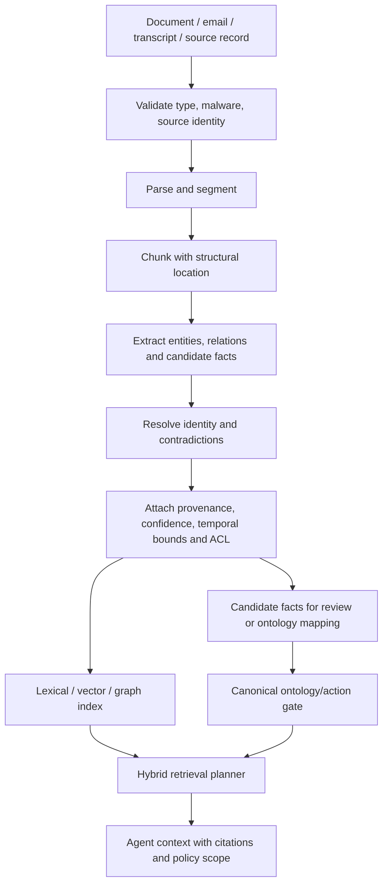

# Document parsing

**Layer:** [06-knowledge-and-evidence](README.md) · **What it is:** Turning PDFs, emails and invoices into structured text and fields with layout and provenance.

> Everything below is copied from the research with a link to where it came from. Nothing here is a new design. New, dated fact-check findings go in the "Fact-check notes" section only.

**Sources in this file:** [Open-source implementations](#open-source-implementations) (1) · [Other companies and products](#other-companies-and-products) (1) · [Research literature](#research-literature) (1) · [Design decisions already in the reference maps](#design-decisions-already-in-the-reference-maps) (1) · [Earlier engineering notes (Phase 2)](#earlier-engineering-notes-phase-2) (1)

## Diagram

_From the former `diagrams/knowledge-ingestion.mmd`._

## Open-source implementations

### 28. Document parsing: Docling and Unstructured

> Source: [open-source-references/docling-unstructured.md](../../open-source-references/docling-unstructured.md) (code study)

- Docling: MIT, Python, version 2.151.1. It depends on `docling-core` (the DoclingDocument model and chunking), `docling-parse` and `docling-ibm-models` (layout, TableFormer), and has a `service_client` module. [Fact] ([pyproject.toml](https://github.com/docling-project/docling/blob/HEAD/pyproject.toml)). Unstructured: Apache-2.0, Python, version 0.27.38-dev. [Fact]
- Verdict: **adopt Docling as a separate HTTP service** called from TypeScript. It is the permissive choice with structure-aware chunking. [Inference]

## Other companies and products

### 7. Document and email ingestion for finance

> Source: [general-references/24-integration-companies.md § 7. Document and email ingestion for finance](../../general-references/24-integration-companies.md#7-document-and-email-ingestion-for-finance)

**Why this matters.** Remittance advices, customer payment confirmations and credit-note requests often arrive as PDF attachments by email. The founder's product has to read the mailbox, decide what each message is, extract the invoice numbers and amounts, and match them to open invoices in the ledger. [Inference]

#### 7.1 Document parsers

| Vendor | What it does | Price (fetched 21 Nov 2026) | Notes |
|---|---|---|---|
| **LlamaParse** (LlamaIndex) | Parsing at four tiers (Fast, Cost-effective, Agentic, Agentic Plus), plus LlamaExtract schema extraction with citations and confidence | Pay-as-you-go: 10,000 free credits a month, then $1.50 per 1,000 credits. Pro: $500 a month for 400,000 credits. Per page: 1, 3, 10 or 25 credits, so $1.50 to $37.50 per 1,000 pages. Layout adds 3 credits. Re-parsing a cached file is free | Extraction credits are charged on top of parsing and were not listed on the page [Fact] ([pricing](https://www.llamaindex.ai/pricing)) |
| **Reducto** | APIs to parse, extract, split, classify and edit | r-1 Parse $10 per 1,000 pages; r-1 mini $1; Extract $20 (includes parsing); Deep Extract $40; Split $20; Classify $7.50. $150 free usage. 20% batch discount | Zero-data-retention agreement and BAA on Growth; VPC or on-prem on Enterprise; EU and Australian residency [Fact] ([pricing](https://reducto.ai/pricing)) |
| **Mindee** | Prebuilt models (invoice, receipt, bank statement, IBAN, bill of lading and others), plus a custom data extractor, classifier and splitter | Starter about 44 a month, Pro about 116 a month (currency not shown); 1 credit per page, 1.5 with a confidence score; overage from $0.05 with a 20% surcharge; 14-day trial | The page had placeholder values, so check before relying on these figures [Fact with caveat] ([pricing](https://www.mindee.com/pricing)) |
| **Rossum** | Transactional-document AI for accounts payable and receivable, with a validation UI and workflows | Not opened | [Unverified] |
| **Nanonets** | Invoice OCR and workflow automation | Not opened | [Unverified] |
| **Docling** (open source, MIT) | Layout and table parsing that runs on your own machines | Free | Study 14 recommends running it as a separate service [Fact] |

**Choice** [Inference]: run Docling yourself for clean digital PDFs, and send hard scans to Reducto Extract (about $0.02 a page) or LlamaParse's Cost-effective tier (about $0.0045 a page). At an estimated 2,000 remittance pages a month per customer, either costs less than $50 a month. Always store the extracted fields with a confidence score and a link back to the source page.

#### 7.2 Email: Nylas compared with direct Gmail and Microsoft Graph

- **Nylas.** One API across Gmail, Microsoft and IMAP for email, calendar, contacts, a scheduler and a meeting notetaker, with webhooks for messages, threads and drafts, bounces, and connect/disconnect/re-authorisation events. Delivery can go to Pub/Sub or SNS. It keeps a 90-day IMAP cache. "Agent Accounts" give an agent its own inbox. Pricing:
  - Free: 5 accounts.
  - Essentials: $15 a month for 10 accounts, then $2.25 each.
  - Pro: from $49 a month for 25 accounts, then $2.00 each.
  - Use of Nylas's *shared* Google OAuth app (which saves you Google's verification process) is a $2,400-a-year add-on.
  [Fact] ([Nylas pricing](https://www.nylas.com/pricing/))
- **Gmail API directly.**
  - Quota: 1,200,000 units per minute per project and 6,000 units per minute per user.
  - Unit costs: `messages.send` 100, `messages.get` 20 (60 with full or raw format), `messages.list` 5, `history.list` 2, `watch` 100.
  - Up to 500 recipients per message.
  [Fact] ([Gmail quota](https://developers.google.com/workspace/gmail/api/reference/quota))
  - Incremental sync uses `history.list` from a stored `historyId`. Push notifications use `users.watch` to a Pub/Sub topic. Nango's guide documents the routing. [Fact] ([Nango Gmail webhooks](https://github.com/NangoHQ/nango/blob/master/docs/api-integrations/google-mail/webhooks.mdx))
  - A product that requests restricted Gmail scopes must pass Google's OAuth verification and, for restricted scopes, an annual security assessment. [Unverified this round: Google's verification page was not opened; this is widely documented]
- **Microsoft Graph directly.** Mail is read through `/me/messages` (or delta queries) and sent with `sendMail`. The scopes are `Mail.Read`, `Mail.Send` and `offline_access`. Change notifications come from Graph subscriptions. [Fact for the scopes] ([Airbyte Outlook docs](https://github.com/airbytehq/airbyte/blob/master/docs/integrations/sources/outlook.md)). The per-mailbox throttling limits were not extracted: the page fetch was truncated. [Unverified]
- **For outbound reminders**, sending *from the customer's own mailbox* through Gmail or Graph gives the best deliverability and keeps replies in the customer's own thread. A transactional sender (SES, Postmark) is needed only for a "no-reply" sender. [Inference]

## Research literature

### 8. Parsing business documents

> Source: [general-references/09-papers-knowledge-layer.md § 8. Parsing business documents](../../general-references/09-papers-knowledge-layer.md#8-parsing-business-documents)

**LayoutLMv3.** arXiv:2204.08387 ([abs](https://arxiv.org/abs/2204.08387)). [Fact] A multimodal transformer using linear patch embeddings (no CNN), pre-trained with masked language modelling, masked image modelling and word-patch alignment on about 11M IIT-CDIP pages. FUNSD F1 92.08, CORD F1 97.46, DocVQA ANLS 83.37 (large). Authors (Huang, Lv, Cui, Lu, Wei, Microsoft) and venue (ACM Multimedia 2022) are from memory [Unverified on page]. Needs fine-tuning per document type.

**DocILE.** Šimsa et al., arXiv:2302.05658 ([abs](https://arxiv.org/abs/2302.05658)). [Fact] 6.7k annotated business documents (invoices and similar) with 55 field classes, 100k synthetic and about 1M unlabelled. Tasks: key information localisation and extraction (KILE) and line item recognition (LIR). Baselines: RoBERTa, LayoutLMv3, Table Transformer.

**Docling.** Auer et al. (IBM), arXiv:2408.09869 ([abs](https://arxiv.org/abs/2408.09869)). [Fact] MIT-licensed PDF converter using a DocLayNet-trained layout model and TableFormer for table structure; runs on commodity hardware.

**OmniDocBench.** Ouyang et al., arXiv:2412.07626 (v2 Mar 2025) ([HTML](https://arxiv.org/html/2412.07626)). [Fact] 981 pages, 9 document types. Metrics: normalised edit distance, TEDS for tables, CDM for formulas, reading order. Overall English edit distance (lower is better): MinerU 0.150, Mathpix 0.191, GPT-4o 0.233, Qwen2-VL-72B 0.252, Marker 0.336. Table TEDS (English): MinerU 78.6, Qwen2-VL 76.8, GPT-4o 72.0. Pipelines win on common layouts such as financial reports; VLMs handle unusual layouts and blurry scans better and struggle with dense pages.

**olmOCR.** Poznanski et al. (AI2), arXiv:2502.18443 (v3 Jul 2025) ([abs](https://arxiv.org/abs/2502.18443)). [Fact] A fine-tuned 7B VLM; about $176 per million pages against over $6,240 for GPT-4o; beats GPT-4o, Gemini Flash 2 and Qwen-2.5-VL on olmOCR-Bench (1,400 PDFs).

**Invoices: native image against parsed text.** Berghaus et al. (Fraunhofer IAIS), arXiv:2509.04469 (Aug 2025) ([HTML](https://arxiv.org/html/2509.04469v1)). [Fact] Test sets: 500 synthetic invoices, 1,000 SROIE receipts, 350 scanned invoices; zero-shot GPT-5, Gemini 2.5 and Gemma 3. Field accuracy from native images against Docling markdown: receipts 87.46% against 47.00% at best; scanned invoices 92.71% against 64.03%; clean invoices 96.50% against 85.14%. IBANs were consistently the weakest field. Exception: tiny models (Gemma 3 4B) did better from markdown on clean invoices.

**UniKIE-Bench.** Ji et al. (Northeastern, Tsinghua, Alibaba), arXiv:2602.07038 ([HTML](https://arxiv.org/html/2602.07038)); date not stated on the page, around early 2026 [Unverified date]. [Fact] 6,133 documents; schema-guided single-pass extraction scored by field exact-match F1. Gemini-3-Pro 82.37 (constrained) and 81.65 (open); best open model Qwen3-VL-8B 79.12 and 67.36. The commercial scenario scored about 45–54 for all models. Failure types: digit misreads, layout misattribution, wrong-field assignment, and hallucinated values for missing fields.
Builder lesson: [Inference] use a layout pipeline (Docling or MinerU) for long text documents feeding retrieval. For field extraction from invoices and receipts, send page images to a frontier VLM with a typed schema. Validate every extracted value with arithmetic checks (line items sum to the subtotal, tax rate × base = tax), format checks (IBAN or bank-account checksums) and existence checks (the supplier resolves to a known object). Route failures to human review.

## Design decisions already in the reference maps

### 6. Document and invoice parsing

> Source: [general-references/32-map-research-and-cost.md § 6. Document and invoice parsing](../../general-references/32-map-research-and-cost.md#6-document-and-invoice-parsing)

**Purpose.** Turn invoices, credit notes, remittance advices and statements into typed objects, so that later questions about them become questions about numbers (section 1). Example: a customer emails a remittance PDF listing three invoice numbers and amounts. The system extracts them, validates them and proposes payment allocations.

**Design to implement.**
- *Field-bearing documents* (invoices, receipts, remittances, POs): send page images to a frontier vision model with the typed object schema. Constrain output to the schema and use "null if absent" so the model does not invent values for missing fields.
- *Validators on every extracted value*:
  - Arithmetic: line items sum to the subtotal; rate × base = tax.
  - Format: account-number or IBAN checksums.
  - Existence: the customer resolves through section 5; the invoice number exists in the ledger.
  - Failures go to a human review queue.
- *Long text documents* (contracts, credit policies) feeding retrieval: run a layout pipeline (Docling or MinerU) into structural elements, then section 7.
- Keep the page image and bounding references for citation.

**Evidence.**
- Field accuracy from native images against Docling markdown (Berghaus et al., arXiv 2509.04469): receipts 87.46% against 47.00% at best; scanned invoices 92.71% against 64.03%; clean invoices 96.50% against 85.14%. IBANs were the weakest field. Tiny models (Gemma 3 4B) did better from markdown on clean invoices.
- UniKIE-Bench: Gemini-3-Pro 82.37 F1; best open model Qwen3-VL-8B 79.12. The commercial scenario scored only about 45–54 for all models. Failure types: digit misreads, layout misattribution, wrong-field assignment, hallucinated values for missing fields (arXiv 2602.07038).
- OmniDocBench: MinerU had the lowest English edit distance (0.150) against GPT-4o (0.233). Pipelines win on common layouts; VLMs win on unusual layouts and blurry scans (arXiv 2412.07626).
- olmOCR: about $176 per million pages against over $6,240 for GPT-4o (arXiv 2502.18443). All from document 09, section 8.

**Copies.** Document 09, section 8 and "What to copy" item 19. https://arxiv.org/html/2509.04469v1 ; https://arxiv.org/html/2602.07038 ; https://arxiv.org/html/2412.07626 ; https://arxiv.org/abs/2408.09869

**Left out.** LayoutLMv3 and DocILE baselines, which need fine-tuning per document type; olmOCR self-hosting until volume justifies it.

**Open questions.**
- The commercial-scenario score of about 45–54 suggests real business documents are much harder than benchmarks. Measure on the customer's own remittances.
- [Inference] Malaysian bank-account formats are not IBANs; the validator needs local rules, which no document covers.
- Docling and MinerU are Python tools [Inference]; that is a stack seam.

## Earlier engineering notes (Phase 2)

### Document pipeline

> Source: former `04-knowledge-engine/knowledge-graph-and-retrieval.md` (moved here in the Nov 2026 restructure)

Ingest → virus/type validation → parse/OCR where necessary → structural segmentation → metadata extraction → chunking with document hierarchy → entity and relation extraction → candidate resolution → provenance attach → embed and index → retrieval evaluation → reprocess/delete handling.

Every chunk/fact should retain document ID, version/hash, source location/page/offset, tenant/ACL, extraction model/prompt version, timestamps, confidence and transformation history.

## Palantir (updated 28 Nov 2026)

- **AIP Document Intelligence** is Foundry's entry point for document extraction: run traditional strategies (raw text, OCR, layout) or VLM strategies on a media set, evaluate quality, speed and token cost, then deploy the chosen strategy as a Python transform for batch or (GA 28 Jul 2026) as Python functions that extract one page at a time. VLM extraction works best with OCR preprocessing passed alongside the page image. Prompts are edited in the app, not in the deployed template, to keep results consistent. Sources: https://www.palantir.com/docs/foundry/document-intelligence/overview/ , https://palantir.com/docs/foundry/document-intelligence/core-concepts/ , https://palantir.com/docs/foundry/document-intelligence/deploy-to-python-transforms/ , https://www.palantir.com/docs/foundry/announcements/2026-07

## Implementation starting points (from source code)

_Repositories read on 28 Nov 2026 at the pinned commit in each link. Licences checked at that commit._

- **Docling 2.154.0, MIT** ([`docling-project/docling`](https://github.com/docling-project/docling/tree/40e490c)) — run as a separate HTTP service; structure-aware chunking via `docling-core`.

## Fact-check notes

_Checked 28 Nov 2026. **Confirmed** = research still matches. **New** = not in the research. **Changed** = research is out of date. Items marked (code) were checked by reading the repository at the pinned commit; others against vendor pages._

- **Changed (code)** — Docling is now 2.154.0 (research: 2.151.1); still MIT.

## Gaps

- Lingyang/AgentOne/Alibaba: not covered — the Alibaba research (docs 07, 08, 28, 31) concentrates on Dataphin, Quick BI, Bailian, UModel, OpenSPG and AgentOne; Palantir and open-source sources cover this component.
