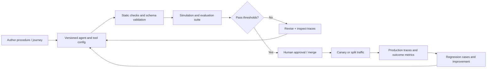

# Release pipeline

**Layer:** [10-change-control](README.md) · **What it is:** Releasing agent and rule changes: diffs, named reviewer, linter, simulation gates, canary, immutable snapshots.

> Everything below is copied from the research with a link to where it came from. Nothing here is a new design. New, dated fact-check findings go in the "Fact-check notes" section only.

**Sources in this file:** [Other companies and products](#other-companies-and-products) (1) · [Design decisions already in the reference maps](#design-decisions-already-in-the-reference-maps) (1) · [Earlier engineering notes (Phase 2)](#earlier-engineering-notes-phase-2) (1)

## Diagram

_From the former `diagrams/workflow-adl.mmd`._

## Other companies and products

### 3.8 Testing and release

> Source: [general-references/18-decagon.md § 3.8 Testing and release](../../general-references/18-decagon.md#38-testing-and-release)

Four test areas recommended: brand/tone, escalation guardrails, knowledge retrieval, AOP logic. Run tests several times because agents are non-deterministic. Replays for small changes; simulations for new AOPs; scheduled regressions; CI/CD on every version; PagerDuty alerts. Release via versions with traffic split and statistical read-out; Experiment Hub inside AOPs. [Vendor claim] https://decagon.ai/modules/testing ; https://decagon.ai/product/testing-qa ; https://decagon.ai/modules/versions

## Design decisions already in the reference maps

### 4. Release pipeline: sessions with diffs, named reviewer, linter, simulation gates, canary, immutable snapshots

> Source: [general-references/34-map-agent-companies.md § 4. Release pipeline: sessions with diffs, named reviewer, linter, simulation gates, canary, immutable snapshots](../../general-references/34-map-agent-companies.md#4-release-pipeline-sessions-with-diffs-named-reviewer-linter-simulation-gates-canary-immutable-snapshots)

**Purpose.** Treat every change to agent behaviour like a software release so a mistake in wording or logic cannot reach debtors without review and tests. Example: an ops lead asks the builder to soften the second-reminder wording; the change sits in a session, the linter flags that the new step reads the balance before identity is verified, the fix is applied, sims pass, the finance controller (named Reviewer) approves, and it ships to 10% of cases first.

**Design to implement.**
- **Session.** `session(id, tenant_id, title, created_by, status: open|in_review|merged|abandoned, base_release_id, chat_thread_id)`. Holds the conversation (human and builder) and pending changes as diffs against the base release. Sessions can be shared, forked and run in parallel. Nothing in a session affects live traffic. A builder agent can review a colleague's session before merge.
- **Project.** Groups related agents (internal reporting agent, external reminder agent) with shared objects and channels so one change to, say, dispute rules updates both and is tested and released together.
- **Linter ("agent checks").** Static analysis over procedures, tools and the company model, severity-ranked with a suggested fix. Initial checks, copied from Sierra's five: (1) tool referenced in a step but not granted; (2) conflicting instructions; (3) a read/lookup tool used to perform a write; (4) a response unsuitable for the channel (long table by SMS/WhatsApp); (5) sensitive lookup with insufficient authentication. Add [Inference] receivables checks: outbound step without a compliance evaluation (§7), write tool without a guard. Linter errors block merge; warnings require reviewer acknowledgement.
- **Required simulations.** Tenant policy lists which simulation suites must pass before merge (e.g. golden set pass^k ≥ threshold, all negative permission tests).
- **Reviewer role.** Tenant configures named reviewer roles per area (finance controller for wording and offers, compliance for outbound rules, engineering owner for tools). Review UI: line-by-line diffs, inline comments, request changes, approve. Merge requires all required reviewers.
- **Release.** On merge, build an **immutable snapshot**: procedure documents, compiled graphs, guidelines, prompts, model IDs and versions per task class, tool and connector schemas (pinned), knowledge index version, compliance configuration. Numbered. Promote QA → staging → production. One-click rollback to any earlier snapshot.
- **Canary / split traffic.** A new production release takes a configurable share (default small, e.g. 10% [Inference]) with per-version reporting; widen, hold or roll back. Assignment is sticky per case so a debtor's case does not flip versions mid-sequence.
- **Experiments vs split releases.** Experiments pick a winner among variants (§12); split releases ship the chosen winner safely. Keep them as separate mechanisms.
- **Platform upgrades.** When we change the runtime, rerun every tenant's regression suite before rollout.
- **Git.** Procedures, tools and guidelines are commits; sessions map to branches; optional branch protection.

**Copies.**
- doc 19 §2C and Key finding 3, Release governance: Agent Checks with the five checks, required simulations, Reviewer role with diffs, comments and request-changes, split-traffic, experiments vs splits, immutable snapshots, rollback; "hundreds of people in one agent" [Vendor claim]. https://sierra.ai/blog/release-governance-guardrails-for-agents-at-scale
- doc 19 §3 Change model and doc 12, Ghostwriter redesign: sessions, fork/share/parallel, Ghostwriter peer review, projects. https://sierra.ai/blog/redesigning-agent-studio-around-ghostwriter
- doc 12, Agent Studio 2.0: private workspaces, numbered snapshots through QA, staging, production. https://sierra.ai/blog/agent-studio-2-0
- doc 12, Sierra ADLC: snapshot contents (code, prompts, model versions, frozen knowledge), regression suite rerun on platform upgrades. https://sierra.ai/blog/agent-development-life-cycle
- doc 18 §2.4 and Key finding 4, Versions: Git commits, gated workspaces as branches, branch protection, staging, randomized traffic split with per-version reporting. https://decagon.ai/modules/versions
- doc 12, Harvey MCP policy engine: Tool Pinner pins tool descriptions and schemas and alerts on drift. https://www.harvey.ai/blog/building-harveys-mcp-policy-engine

**Left out, and why.** Hundreds-of-editors scale features; at 100 to 1,000 staff a handful of people edit [Inference]. Glean's ADLC review depth by scope is kept only as a rule of thumb (doc 21 §3.6 says it is a guide, not tooling).

**Open questions.** Default canary share and widen criteria are not published by any vendor. Sierra's release governance was earlier known only via Unite.ai (doc 12) and is now a primary read (doc 19).

## Earlier engineering notes (Phase 2)

### H7 — Agent configuration is a versioned product artifact

> Source: former `17-decisions-and-tradeoffs/architecture-hypotheses.md` (moved here in the Nov 2026 restructure)

**Hypothesis:** agent journeys/procedures/tools/guardrails/evaluation sets are versioned and released through review, simulation, regression and canary. Do not allow prompt-only production changes without traceability.

**Evidence:** Sierra's Agent Studio/release governance and Decagon's AOP approach.

## Open-source implementations (added 28 Nov 2026)

- promptfoo 0.126.0 (MIT) for prompt/tool regression in CI ([eval-and-observability-tools](../../open-source-references/eval-and-observability-tools.md)); [openfeature](../../open-source-references/openfeature.md) flags for canary and rollback.

## Fact-check notes

_Reviewed 28 Nov 2026: this component's material is design pattern, research literature or business context without version, licence or launch-status claims, so there was nothing time-sensitive to re-check. Company facts it cites were spot-checked where they feed engineering (Sierra, Decagon, Palantir naming)._

## Gaps

- No palantir material in the research yet.
- No lingyang, AgentOne and Alibaba material in the research yet.
- No research literature material in the research yet.
