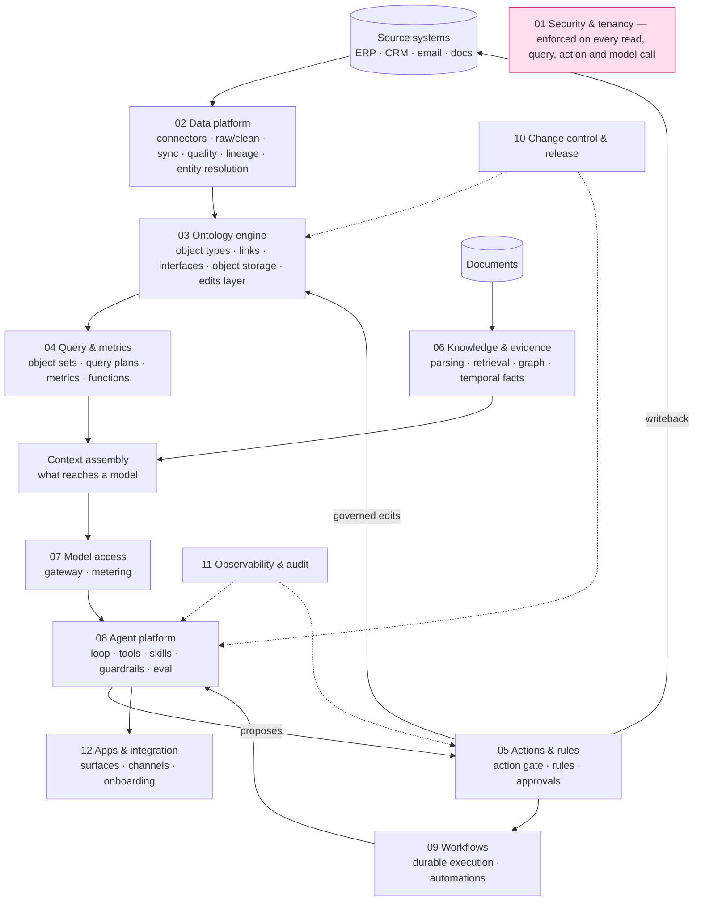

# Engineering

What we build, one folder per layer and one file per component. Every component file is assembled from the references: each section is copied from a general reference, an open-source reference, a reference map or an earlier engineering note, with a link to where it came from. Nothing here is new design. Fact-check findings are added as dated notes inside each file.

## How the layers connect

## Build order

From the original research architecture (see [00-overview/build-sequence](00-overview/build-sequence.md)): tenant/security floor → source data lifecycle → versioned ontology/object runtime → object-set and semantic query → deterministic rules and governed actions → evidence/context → agent runtime → durable workflow and controlled release → application/integration surfaces.

## Every component file has the same sections

1. **What it is** — one line.
2. **Diagram** — where one existed.
3. **Palantir** · **Lingyang, AgentOne and Alibaba** · **Open-source implementations** · **Other companies and products** · **Research literature** — copied source material.
4. **Design decisions already in the reference maps** — what maps 30–35 already concluded.
5. **Earlier engineering notes (Phase 2)** — the previous engineering docs, moved here.
6. **Fact-check notes** — dated checks against current sources.
7. **Gaps** — source categories with no material yet.

## Layers

### [00-overview](00-overview/README.md) — Overview

The whole system, build order, platform comparison, open hypotheses and vocabulary.

| Component | What it is | Lines | Sources |
|---|---|---:|---:|
| [system-architecture](00-overview/system-architecture.md) | The whole system on one page: the product thesis, the six research maps as one architecture, and the layer boundaries. | 267 | 7 |
| [build-sequence](00-overview/build-sequence.md) | The order in which layers must be built, and the separate order in which research is done. | 65 | 3 |
| [platform-comparison](00-overview/platform-comparison.md) | Palantir, Lingyang/AgentOne, Fabric IQ, Glean, Sierra, Decagon and Harvey compared at architecture level. | 358 | 5 |
| [hypotheses-and-decisions](00-overview/hypotheses-and-decisions.md) | Architecture hypotheses that are proposed but not yet decided, and the gate for deciding them. | 118 | 1 |
| [terminology](00-overview/terminology.md) | Shared vocabulary and the research charter that defines scope. | 118 | 2 |
| [bill-of-materials](00-overview/bill-of-materials.md) | Every recommended building block (depend / copy design / write), licences, and what was re-verified in source on 28 Nov 2026. | 87 | 2 |

### [01-security](01-security/README.md) — Security, tenancy and identity

Wraps every other layer. Tenant isolation, identity, authorization, markings and row/column/object policies, agent identity, retention, threat model.

| Component | What it is | Lines | Sources |
|---|---|---:|---:|
| [tenancy-and-isolation](01-security/tenancy-and-isolation.md) | How one customer's data, objects and agents are kept separate from another's, and which invariants must hold end to end. | 171 | 9 |
| [identity-and-auth](01-security/identity-and-auth.md) | Who a user or service is: authentication, SSO, groups, roles, scoped sessions and third-party app tokens. | 96 | 4 |
| [authorization-model](01-security/authorization-model.md) | How allow/deny decisions are made on data, objects, links, actions and functions, and which engine evaluates them. | 302 | 12 |
| [markings-row-column-object-policies](01-security/markings-row-column-object-policies.md) | Mandatory labels (markings), row and column policies, object and property security, and purpose-based checks. | 225 | 8 |
| [agent-identity-and-token-scope](01-security/agent-identity-and-token-scope.md) | Agents as their own principals: what an agent may see and do is the intersection of its scope and the user's. | 136 | 4 |
| [retention-deletion-encryption](01-security/retention-deletion-encryption.md) | Data lifetime, lineage-aware deletion, sensitive-data scanning, encryption, privacy engineering and certifications. | 104 | 5 |
| [threat-model](01-security/threat-model.md) | Attack scenarios, trust boundaries and the negative-test matrix for tenant and matter isolation. | 104 | 2 |

### [02-data-platform](02-data-platform/README.md) — Data platform

Source data becomes trustworthy operational state: connectors, raw/clean layers, sync and rebuild, data quality, lineage, entity resolution, event log.

| Component | What it is | Lines | Sources |
|---|---|---:|---:|
| [connectors-and-ingestion](02-data-platform/connectors-and-ingestion.md) | Getting data out of source systems: connector types, extraction, webhooks, the source-record contract and reliability rules. | 535 | 19 |
| [raw-clean-layers-and-transforms](02-data-platform/raw-clean-layers-and-transforms.md) | Raw versus clean datasets, transforms, views and the 'publishing a definition generates the build' idea. | 402 | 9 |
| [sync-incremental-rebuild](02-data-platform/sync-incremental-rebuild.md) | Keeping clean state current: CDC, streaming, incremental builds, schedules, dataset branching and rebuild semantics. | 274 | 7 |
| [data-quality](02-data-platform/data-quality.md) | Health checks, expectations and strong/weak quality rules that block or flag bad data. | 85 | 2 |
| [lineage-and-catalog](02-data-platform/lineage-and-catalog.md) | Where every dataset and object came from, and the catalog that lets people find them. | 93 | 3 |
| [entity-resolution](02-data-platform/entity-resolution.md) | Deciding that records from different systems are the same customer, matter or invoice. | 92 | 3 |
| [object-centric-event-log](02-data-platform/object-centric-event-log.md) | An event log keyed to business objects (process mining), and how it differs from the ontology. | 217 | 4 |

### [03-ontology-engine](03-ontology-engine/README.md) — Ontology engine

The company model: typed object types, properties, links and interfaces; their storage and indexing; the edits layer; schema evolution; drafting; SDK/API/MCP.

| Component | What it is | Lines | Sources |
|---|---|---:|---:|
| [object-type-registry](03-ontology-engine/object-type-registry.md) | The schema of the company model: object types, properties, identity, link types, interfaces, and how they are validated. | 594 | 30 |
| [semantic-model-format](03-ontology-engine/semantic-model-format.md) | The file format a company model is written in: objects, keys, relationships, metrics, synonyms, mappings (Ossie, UModel, Palantir SDK metadata). | 224 | 6 |
| [object-storage-and-indexing](03-ontology-engine/object-storage-and-indexing.md) | Where object instances live and how they are indexed and kept in step with source data (Palantir OSv2/Funnel and equivalents). | 298 | 14 |
| [edits-and-merge-precedence](03-ontology-engine/edits-and-merge-precedence.md) | How user and agent edits are stored as a layer over source data, and which wins when they conflict. | 97 | 3 |
| [schema-evolution-and-branching](03-ontology-engine/schema-evolution-and-branching.md) | Changing the model safely: versioning, migrations, branches, proposals and review of ontology changes. | 74 | 4 |
| [ontology-drafting-and-cold-start](03-ontology-engine/ontology-drafting-and-cold-start.md) | Drafting a first model with LLMs from a company's apps and documents, and its limits. | 184 | 6 |
| [sdk-api-and-mcp](03-ontology-engine/sdk-api-and-mcp.md) | How code and agents talk to the ontology: generated SDKs, REST API, developer console and Ontology MCP. | 201 | 6 |

### [04-query-and-metrics](04-query-and-metrics/README.md) — Query and metrics

Answering with typed meaning: object-set queries, inspectable query plans, governed metrics, guarded text-to-SQL, arithmetic in code, functions.

| Component | What it is | Lines | Sources |
|---|---|---:|---:|
| [object-set-queries](04-query-and-metrics/object-set-queries.md) | Querying typed objects as sets: filters, link traversal, aggregation, pagination and consistency. | 222 | 10 |
| [query-plans-and-compiler](04-query-and-metrics/query-plans-and-compiler.md) | Turning a question into an inspectable, typed plan, then into executed steps (logical, optimised, physical). | 264 | 8 |
| [metrics-and-semantic-layer](04-query-and-metrics/metrics-and-semantic-layer.md) | Governed metric definitions: grammar, time windows, safe joins and compilation to SQL. | 603 | 17 |
| [text-to-sql-fallback-and-repair](04-query-and-metrics/text-to-sql-fallback-and-repair.md) | When no governed metric fits: generated queries as untrusted proposals that are checked and repaired against the ontology. | 130 | 4 |
| [numeric-reasoning](04-query-and-metrics/numeric-reasoning.md) | Arithmetic done in executed code with a trace, never in the model's head. | 66 | 2 |
| [functions](04-query-and-metrics/functions.md) | User-written logic attached to the ontology (functions, AIP Logic) that queries and computes over objects. | 113 | 3 |

### [05-actions-and-rules](05-actions-and-rules/README.md) — Actions and rules

The only way state changes: typed actions through a gate with transactions, deterministic rules and decision tables, dry runs, approvals and action marking.

| Component | What it is | Lines | Sources |
|---|---|---:|---:|
| [action-types](05-actions-and-rules/action-types.md) | The only way state changes: typed, permissioned action definitions with parameters, rules and side effects. | 220 | 5 |
| [action-gate-and-transactions](05-actions-and-rules/action-gate-and-transactions.md) | Executing an action: checks, dry run, transaction boundary, isolation, outbox and external effects. | 313 | 9 |
| [rules-and-decision-tables](05-actions-and-rules/rules-and-decision-tables.md) | Business rules as governed, versioned objects evaluated by deterministic engines and decision tables. | 345 | 10 |
| [scenarios-and-dry-runs](05-actions-and-rules/scenarios-and-dry-runs.md) | Trying a change against a copy of state before committing it. | 70 | 2 |
| [approvals-and-action-marking](05-actions-and-rules/approvals-and-action-marking.md) | Marking each action allowed / needs approval / never allowed, approval flows, and keeping money movement away from the model. | 170 | 6 |

### [06-knowledge-and-evidence](06-knowledge-and-evidence/README.md) — Knowledge and evidence

Evidence that complements the operational model: document parsing, retrieval, knowledge graphs, temporal facts and memory, context assembly, provenance.

| Component | What it is | Lines | Sources |
|---|---|---:|---:|
| [document-parsing](06-knowledge-and-evidence/document-parsing.md) | Turning PDFs, emails and invoices into structured text and fields with layout and provenance. | 159 | 5 |
| [retrieval-and-search](06-knowledge-and-evidence/retrieval-and-search.md) | Finding the right passages: chunking, hybrid search, reranking and permission-aware retrieval. | 297 | 12 |
| [knowledge-graph-retrieval](06-knowledge-and-evidence/knowledge-graph-retrieval.md) | Graph-structured knowledge extracted from text, and when graph retrieval is and is not worth it. | 382 | 12 |
| [temporal-facts-and-memory-store](06-knowledge-and-evidence/temporal-facts-and-memory-store.md) | Facts with valid-time and record-time, invalidation, two-tier (learned vs certified) knowledge and memory stores. | 393 | 14 |
| [context-assembly-and-grounding](06-knowledge-and-evidence/context-assembly-and-grounding.md) | What reaches the model: layered context, business terms, synonyms, routing and marking filters. | 330 | 11 |
| [provenance-and-answer-transparency](06-knowledge-and-evidence/provenance-and-answer-transparency.md) | Showing the business logic, executed query and sources behind every answer. | 66 | 1 |

### [07-model-access](07-model-access/README.md) — Model access layer

One governed path to every model: gateway and routing, rate limits, metering and cost, provider retention.

| Component | What it is | Lines | Sources |
|---|---|---:|---:|
| [model-gateway-and-routing](07-model-access/model-gateway-and-routing.md) | One proxy for all model calls: provider catalogue, enablement, routing and bring-your-own-model. | 213 | 6 |
| [rate-limits-metering-cost](07-model-access/rate-limits-metering-cost.md) | Rate limits, token and compute accounting, caching and the cost model per customer. | 289 | 10 |
| [data-retention-and-byom](07-model-access/data-retention-and-byom.md) | What model providers keep, zero-retention guarantees and regional hosting. | 41 | 1 |

### [08-agent-platform](08-agent-platform/README.md) — Agent platform

A governed operator, not a prompt: agent loop and runtime, tools, session state, skills and procedures, MCP, guardrails, human-in-the-loop, evaluation.

| Component | What it is | Lines | Sources |
|---|---|---:|---:|
| [agent-loop-and-runtime](08-agent-platform/agent-loop-and-runtime.md) | The agent loop and the runtime that hosts it: frameworks, model orchestration and role-packaged agents. | 455 | 20 |
| [tool-design](08-agent-platform/tool-design.md) | Designing the tools an agent calls: granularity, identities, descriptions and errors. | 153 | 5 |
| [session-state-and-memory](08-agent-platform/session-state-and-memory.md) | Durable agent sessions, access to the task record, and per-customer memory across interactions. | 253 | 8 |
| [skills-and-procedures](08-agent-platform/skills-and-procedures.md) | Capturing a company's procedures as versioned skills/journeys/AOPs, and the builder that writes them. | 243 | 10 |
| [mcp-servers](08-agent-platform/mcp-servers.md) | Exposing and consuming tools over the Model Context Protocol (builder vs consumer servers). | 214 | 7 |
| [guardrails-and-injection](08-agent-platform/guardrails-and-injection.md) | Runtime defence: supervisors, prompt-injection defences, safe tool defaults and pre-send compliance. | 228 | 8 |
| [human-in-the-loop-and-handoff](08-agent-platform/human-in-the-loop-and-handoff.md) | When the agent asks, waits for approval, or hands the case to a human. | 122 | 5 |
| [evaluation-and-simulation](08-agent-platform/evaluation-and-simulation.md) | Golden sets, state-based checks, simulated users, replay of past runs, experiments and always-on monitoring. | 455 | 20 |

### [09-workflows](09-workflows/README.md) — Workflows and automation

Durable execution, automations and triggers, and long-running outcome workflows.

| Component | What it is | Lines | Sources |
|---|---|---:|---:|
| [durable-execution](09-workflows/durable-execution.md) | Workflows that survive crashes: event-history replay vs durable steps, and where exactly-once stops. | 326 | 9 |
| [automations-and-triggers](09-workflows/automations-and-triggers.md) | Triggers on object changes, schedules and events that start actions or agents, and their limits. | 426 | 20 |
| [long-running-outcome-workflows](09-workflows/long-running-outcome-workflows.md) | Work that plans toward an outcome over weeks: cases, suppression windows and audit. | 88 | 2 |

### [10-change-control](10-change-control/README.md) — Change control and release

Branches and proposals, the release pipeline, packaging and upgrades, deployment and infrastructure.

| Component | What it is | Lines | Sources |
|---|---|---:|---:|
| [branches-proposals-review](10-change-control/branches-proposals-review.md) | Branch, propose, review and merge for ontology, rules and agent configuration. | 84 | 1 |
| [release-pipeline](10-change-control/release-pipeline.md) | Releasing agent and rule changes: diffs, named reviewer, linter, simulation gates, canary, immutable snapshots. | 93 | 3 |
| [packaging-and-upgrades](10-change-control/packaging-and-upgrades.md) | Packaging a use case as a versioned template and upgrading installed copies. | 111 | 3 |
| [deployment-and-infra](10-change-control/deployment-and-infra.md) | Where it runs: continuous delivery, deployment options, infrastructure and the bill of materials. | 334 | 10 |

### [11-observability](11-observability/README.md) — Observability and audit

Audit log, tracing and monitoring, and the central control page with a kill switch.

| Component | What it is | Lines | Sources |
|---|---|---:|---:|
| [audit-log](11-observability/audit-log.md) | What gets audited, in which categories, and how audit logs are kept. | 95 | 2 |
| [tracing-and-monitoring](11-observability/tracing-and-monitoring.md) | Traces of every agent step, monitoring and debugging tools. | 118 | 5 |
| [control-page-and-kill-switch](11-observability/control-page-and-kill-switch.md) | One page to see every agent, its KPI and permissions, with a kill switch. | 72 | 3 |

### [12-apps-and-integration](12-apps-and-integration/README.md) — Applications and integration

Application surfaces, channels, writeback to external systems, customer onboarding.

| Component | What it is | Lines | Sources |
|---|---|---:|---:|
| [app-surfaces](12-apps-and-integration/app-surfaces.md) | The applications built on the ontology: operational apps, object views, analysis tools and AI app builders. | 263 | 13 |
| [channels](12-apps-and-integration/channels.md) | Where agents meet people: chat, email, voice, messaging apps. | 91 | 4 |
| [external-integrations-and-writeback](12-apps-and-integration/external-integrations-and-writeback.md) | Writing results back to source systems, unified APIs and embedded-integration vendors. | 226 | 4 |
| [customer-onboarding](12-apps-and-integration/customer-onboarding.md) | Technical onboarding of a new customer: forward-deployed engineering, self-setup flow and time to live. | 176 | 7 |

### [13-domain-packs](13-domain-packs/README.md) — Domain packs

The domains the platform is validated against: receivables (original baseline), legal (current pivot), finance, construction.

| Component | What it is | Lines | Sources |
|---|---|---:|---:|
| [receivables-baseline](13-domain-packs/receivables-baseline.md) | The original receivables/collections domain model and the evidence behind it. | 192 | 7 |
| [legal](13-domain-packs/legal.md) | The legal-market pivot: candidate objects and workflows, what must not change, and the law-firm interview guide. | 280 | 6 |
| [finance](13-domain-packs/finance.md) | Finance domain pack: candidate objects, workflows and deterministic rules. | 83 | 2 |
| [construction](13-domain-packs/construction.md) | Construction domain pack — a transferability test. | 47 | 1 |
